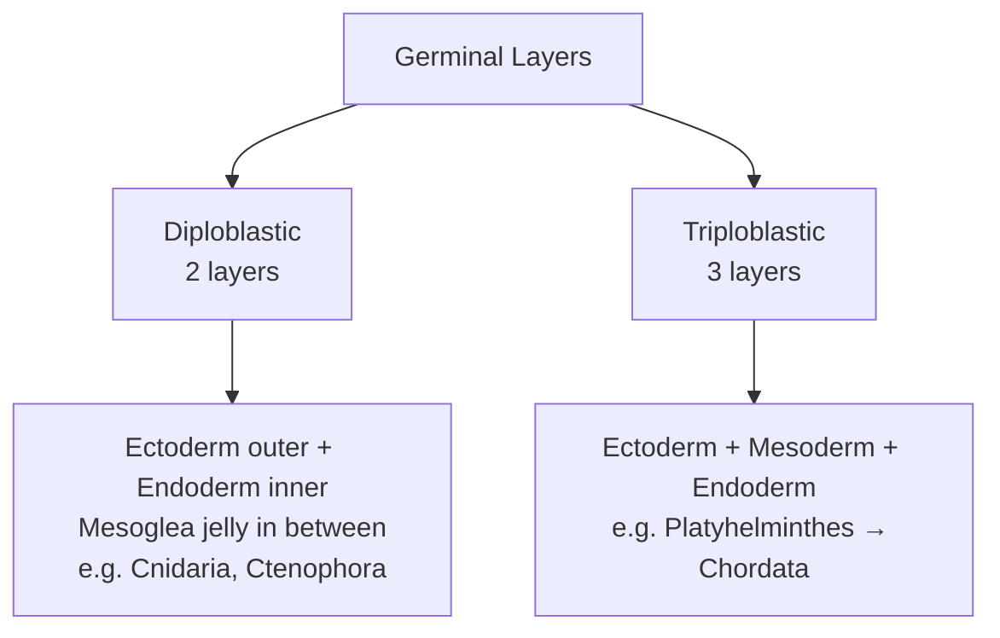
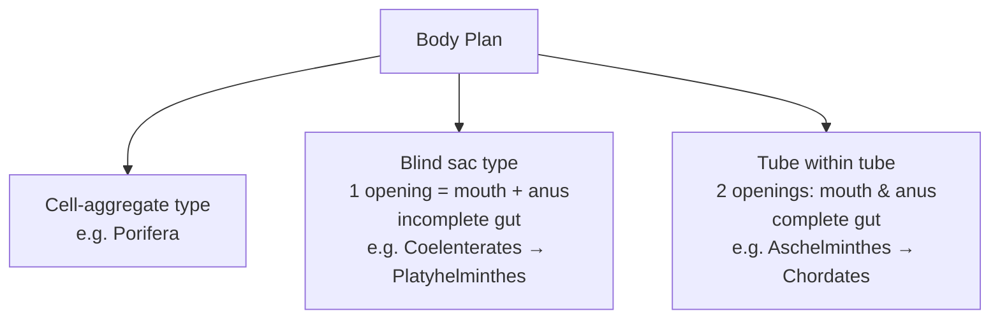
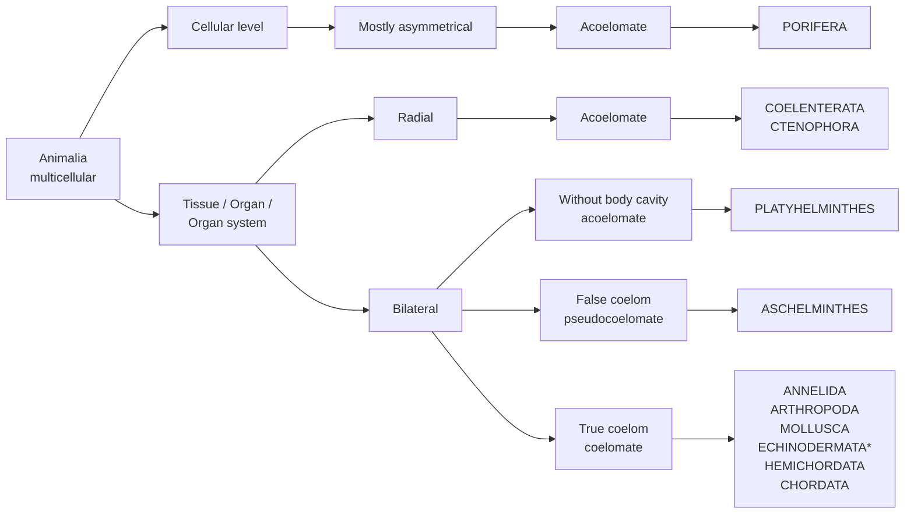
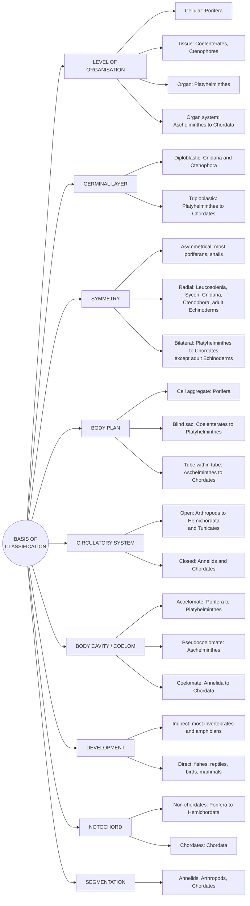

# 🐾 Animal Kingdom — Easy Notes (Part 1: Basis of Classification)

> Source: ALLEN NEET Biology, Chapter 04, pages 215–221 + mind map.
> Nothing skipped — just rearranged so it's easier to remember.

---

## 1. Introduction

- Animals around us have **different structures and forms**.
- **Over 1 million species** of animals have been described → so **classification is needed**.
- **Life** = a **physiochemical entity** showing:
  - 🌱 **G**rowth
  - 🏃 **M**ovement
  - ⚡ **I**rritability
  - 👶 **R**eproduction
  - 🧠 Trick: **"GMIR"** → *"Give Me Instant Results"*
- Classification helps give a **systematic position to newly described species**.

---

## 2. The 11 Important Phyla (in order)

| # | Phylum | Examples |
|---|--------|----------|
| 1 | **Porifera** | Sponges (*Leucosolenia, Sycon*) |
| 2 | **Coelenterata / Cnidaria** | *Hydra*, Jellyfish |
| 3 | **Ctenophora** | *Pleurobrachia, Ctenoplana* |
| 4 | **Platyhelminthes** | Flatworms (e.g. Tapeworm) |
| 5 | **Nemathelminthes / Aschelminthes** | Roundworm (e.g. *Ascaris*) |
| 6 | **Annelida** | Earthworm, Leech |
| 7 | **Arthropoda** | Insect, Scorpion, Fly |
| 8 | **Mollusca** | Snail, *Pila*, *Octopus* |
| 9 | **Echinodermata** | Starfish |
| 10 | **Hemichordata** | *Balanoglossus* |
| 11 | **Chordata** | Fish, Snake, Birds, Monkey |

### 🧠 Mnemonic for the order
**"P**lease **C**ome **C**hildren, **P**lay **N**icely **A**nd **A**ll **M**ake **E**veryone **H**appy **C**heerfully"

| Word | Phylum |
|------|--------|
| Please | Porifera |
| Come | Coelenterata |
| Children | Ctenophora |
| Play | Platyhelminthes |
| Nicely | Nemathelminthes (Aschelminthes) |
| And | Annelida |
| All | Arthropoda |
| Make | Mollusca |
| Everyone | Echinodermata |
| Happy | Hemichordata |
| Cheerfully | Chordata |

> ⭐ **Why the order matters:** Almost every rule in this chapter is written as a **range** — "Porifera **to** Platyhelminthes", "Aschelminthes **to** Chordata". If you know the order, you know the answer.


---

## 3. Basis of Classification

- Animals look different, but they share some **fundamental features**:
  - arrangement of **cells**
  - **body symmetry**
  - nature of **coelom**
  - patterns of **digestive, circulatory or reproductive systems**
- These features are the **basis of animal classification**.

### The 8 features in this chapter

| No. | Feature | Question it answers |
|-----|---------|---------------------|
| (i) | Level of organisation | How are cells arranged? |
| (ii) | Symmetry | Can the body be cut into equal halves? |
| (iii) | Germinal (embryonic) layer | 2 layers or 3 layers? |
| (iv) | Coelom (body cavity) | Is there a cavity, and is it lined by mesoderm? |
| (v) | Metamerism | Is the body segmented? |
| (vi) | Body plan | One opening or two in the gut? |
| (vii) | Notochord | Present or absent? |
| (viii) | Circulatory system | Open or closed? |

---

## 4. Levels of Organisation

All animals are **multicellular**, but cells are not organised the same way.

```
Cells  ──►  Tissues  ──►  Organs  ──►  Organ systems
(Cellular)  (Tissue)      (Organ)       (Organ system)
```

| Level | What happens | Examples |
|-------|--------------|----------|
| **Cellular** | Cells form **loose cell aggregates**; **division of labour** among cells; **tissues absent** | Sponges (**Porifera**) |
| **Tissue** | Cells doing the **same function** are grouped into **tissues** | **Coelenterates & Ctenophores** |
| **Organ** | Tissues group to form **organs** | **Platyhelminthes** |
| **Organ system** | Organs organise into **organ systems** | **Aschelminthes, Annelida, Arthropoda, Mollusca, Echinodermata, Hemichordata, Chordata** (= Aschelminthes → Chordata) |

### 🧠 Remember
- **1 phylum** → Cellular (Porifera)
- **2 phyla** → Tissue (Cnidaria, Ctenophora)
- **1 phylum** → Organ (Platyhelminthes)
- **Everything else** → Organ system (Aschelminthes onwards)


---

## 5. Symmetry

**Symmetry** = arrangement of similar body parts on 2 sides of the main axis of the body.

| | ❌ Asymmetrical | ⭕ Radial | ⬅️➡️ Bilateral |
|--|----------------|-----------|----------------|
| **Meaning** | Body **cannot** be divided into 2 similar parts | **Any plane** through the central axis divides body into 2 identical halves | Body divides into identical **right & left halves** in **only ONE plane** |
| **Examples** | **Most Poriferans**, **Snails** | **Some Poriferans** (*Sycon, Leucosolenia*), **Cnidarians, Ctenophores, adult Echinoderms** | **Platyhelminthes → Chordata** (except adult Echinoderms) |
| **Picture** | Irregular blob | Jellyfish / starfish (many cutting planes) | Crab, Human (one line down the middle) |

### ⚠️ Tricky points (common MCQ traps)
- **Porifera** = **mostly asymmetrical**, BUT *Sycon* & *Leucosolenia* are **radial**.
- **Snail** is **asymmetrical** even though Mollusca is a "higher" phylum.
- **Echinodermata**: **larva = bilateral**, **adult = radial** → "depends on the stage".

```
Asymmetry ─► Most sponges, Snails
Radial    ─► Sycon, Leucosolenia, Cnidaria, Ctenophora, ADULT Echinoderms
Bilateral ─► Platyhelminthes → Chordata (minus adult Echinoderms)
```

---

## 6. Germinal (Embryonic) Layers



| | Diploblastic | Triploblastic |
|--|--------------|---------------|
| No. of layers | **2** | **3** |
| Layers | Outer **ectoderm** + inner **endoderm** | Outer **ectoderm**, middle **mesoderm**, inner **endoderm** |
| Middle part | **Mesoglea** — an **undifferentiated jelly-like layer** (NOT a true layer) | **Mesoderm** (a true layer) |
| Examples | **Cnidaria & Ctenophora** | **Platyhelminthes → Chordates** |

### 🧠 Remember
- **Di = 2 = the "jelly" animals** (jellyfish, comb jellies) → they have **jelly (mesoglea)** inside!
- Diagram: Diploblastic ring = blue (ectoderm) + **brown jelly (mesoglea)** + blue (endoderm). Triploblastic ring = blue + **red mesoderm** + blue.
- Porifera is not counted here (no true tissues/layers).

---

## 7. Body Cavity or Coelom

**Coelom** = cavity between the **body wall** and the **gut wall**. Very important in classification.

| | Acoelomate | Pseudocoelomate (False coelom) | Coelomate (True coelom) |
|--|-----------|-------------------------------|-------------------------|
| Cavity? | **Absent** | Present | Present |
| Lined by mesoderm? | — | **NO** — mesoderm is present as **scattered pouches** between ectoderm and endoderm | **YES** — fully lined by mesoderm, filled with **coelomic fluid** |
| Examples | **Porifera → Platyhelminthes** | **Aschelminthes** | **Annelida → Chordata** |

| Porifera | Cnidaria | Ctenophora | Platy | Aschel | Annelida | Arthropoda | Mollusca | Echino | Hemi | Chordata |
|---|---|---|---|---|---|---|---|---|---|---|
| Acoelomate | Acoelomate | Acoelomate | Acoelomate | **Pseudo** | Coelomate | Coelomate | Coelomate | Coelomate | Coelomate | Coelomate |

### 🧠 Remember
- **"Pseudo = only Aschelminthes"** (the roundworm is the only "fake").
- **True coelom begins with Annelida** (earthworm).

### Functions of the coelom
- 🛡️ **Protective cushion** for internal organs.
- 💧 In **worms**, it acts as a **hydroskeleton**.
- 🔄 Allows **movement of internal organs**.

---

## 8. Segmentation (Metamerism)

- **Metameric** animals: **Annelids, Arthropods, Chordates**.
- Body is divided **externally AND internally** into segments, with **serial repetition of at least some organs**.
- Example: **Earthworm**.
- This pattern = **metameric segmentation**; the phenomenon = **metamerism**.

### 🧠 Mnemonic: **"AAC"** → *"**A**ll **A**nimals **C**hain"* → **A**nnelida, **A**rthropoda, **C**hordata
(Think of an earthworm's rings like chain links.)

---

## 9. Body Plan



| Type | Gut | Openings | Examples |
|------|-----|----------|----------|
| **Cell-aggregate** | No gut | — | **Porifera** |
| **Blind sac** | **Incomplete** digestive tract | **1** opening = mouth **and** anus | **Coelenterates → Platyhelminthes** (e.g. *Hydra*) |
| **Tube within tube** | **Complete** digestive tract | **2** separate openings: mouth & anus | **Aschelminthes → Chordates** (e.g. roundworm) |

### 🧠 Remember
- **Blind sac** = like a **bag/sock** — food goes in and waste comes out the **same hole**.
- **Tube within tube** = a **pipe** inside the body tube — in at mouth, out at anus.
- Aschelminthes is the **first** with a complete gut.

---

## 10. NCERT Q: Intracellular vs Extracellular Digestion

| | Intracellular | Extracellular |
|--|---------------|---------------|
| Where | **Inside the food vacuole** within the cell | **Outside the cell**, in the **lumen of alimentary canal** |
| Enzymes | **Lysosome** enzymes secreted into food vacuole | **Glands of alimentary canal** secrete enzymes into lumen |
| Type | **Only chemical** digestion | **Mechanical + chemical** digestion |
| Found in | **Protozoans & Poriferans** | **Aschelminthes → Mammals** |

> ⭐ **Coelenterata and Ctenophora** show **BOTH** intracellular **and** extracellular digestion.

```
Protozoa, Porifera     →  Intracellular only
Cnidaria, Ctenophora   →  BOTH
Aschelminthes → Mammals →  Extracellular
```

---

## 11. Notochord

**Notochord** = a **mesodermally derived**, **supporting rod-like** structure formed on the **dorsal side** during **embryonic development** in some animals.

| | Non-chordates | Chordates |
|--|---------------|-----------|
| Notochord | **Absent** | **Present** |
| Examples | **Porifera → Hemichordata** | **Chordata** |

> ⚠️ **Trap:** Hemichordata has "chordata" in its name but is a **NON-chordate**.

### 🧠 Remember the 3 words: **Mesoderm – Rod – Dorsal (back side)**

---

## 12. Circulatory System

| | Open type | Closed type |
|--|-----------|-------------|
| How | Blood is **pumped out of the heart**; cells & tissues are **directly bathed** in it | Blood flows through **vessels of varying diameter** — **arteries, veins, capillaries** |
| Examples | **Arthropods, Molluscs, Echinoderms, Hemichordata** (mind map adds **Tunicates**) | **Annelids** and **most Chordates** |

### 🧠 Remember
- **Open** = "**A M E H**" → *"**A**ll **M**y **E**ggs **H**atch"* → **A**rthropoda, **M**ollusca, **E**chinodermata, **H**emichordata (+ Tunicates)
- **Closed** = **Annelida** + most **Chordata**
- ⚠️ Annelida (earthworm) is **closed** even though it comes *before* Arthropoda in order.

---

## 13. Development

| | Indirect | Direct |
|--|----------|--------|
| Larval stage? | **YES** — a **sexually immature larval stage** with **different food requirements** than adult | **NO** — embryo develops into a mature individual directly |
| Examples | **Most invertebrates & Amphibians** (e.g. frog → tadpole) | **Fishes, Reptiles, Birds, Mammals** |

### 🧠 Remember
- **Indirect = "in-between baby"** (larva comes in between, like tadpole / caterpillar).
- **Direct = "mini adult"** comes out.

---

## 14. Oviparous vs Viviparous

| Oviparous | Viviparous |
|-----------|------------|
| **Egg-laying** animals | **Give birth to young ones** instead of laying eggs |

### NCERT Q: Could the number of eggs/young ones produced by oviparous and viviparous mothers be equal? Why?
**Ans: No.**
- **Oviparous:** most early development happens **outside**, so young ones face dangers (high wind, being eaten by other animals) → they produce **more eggs**.
- **Viviparous:** early development happens **safely inside the mother's body** → **high survival** → they produce **fewer** young.

---

## 15. Other NCERT Questions (with answers)

**Q. How useful is the study of body cavity and coelom in classification?**
**Ans:** The presence/absence of a body cavity and whether it is lined by mesoderm divides animals into **acoelomates, pseudocoelomates and coelomates** — a major dividing line between phyla. *(Question in book; answer based on section 7.)*

**Q. What difficulties would you face if common fundamental features are not taken into account?**
**Ans:**
- It would be very hard to classify **each organism individually**.
- **New species found every day** could not be added.
- To study animal diversity, classification must be based on **common basic features**.

**Q. If given a specimen, what steps would you follow to classify it?**
**Ans:** Check these basic features:
| Features to check | | |
|--|--|--|
| (a) Level of organisation | (b) Body symmetry | (c) Nature of coelom |
| (d) Pattern of digestive system | (e) Circulatory system | (f) Germinal layer |
| (g) Segmentation | (h) Notochord (presence/absence) | (i) Development |

**Q. Difference between direct and indirect development?** → See section 13.

**Q. Intracellular vs extracellular digestion?** → See section 10.

---

## 16. 🗺️ Big Classification Flowchart (Page 220)



\* Echinodermata shows **radial or bilateral** symmetry depending on stage.

---

## 17. ⭐ MASTER CHART — All 11 Phyla × All Features

This is the most important table. One row = one phylum, everything in one place.

| Phylum | Level | Symmetry | Germ layers | Coelom | Body plan | Segmented | Circulation | Notochord |
|--------|-------|----------|-------------|--------|-----------|-----------|-------------|-----------|
| **Porifera** | Cellular | Mostly asym. (Sycon, Leucosolenia radial) | — | Acoelomate | Cell-aggregate | No | — | ❌ |
| **Cnidaria** | Tissue | Radial | Diploblastic | Acoelomate | Blind sac | No | — | ❌ |
| **Ctenophora** | Tissue | Radial | Diploblastic | Acoelomate | Blind sac | No | — | ❌ |
| **Platyhelminthes** | Organ | Bilateral | Triploblastic | Acoelomate | Blind sac | No | — | ❌ |
| **Aschelminthes** | Organ system | Bilateral | Triploblastic | **Pseudo** | Tube in tube | No | — | ❌ |
| **Annelida** | Organ system | Bilateral | Triploblastic | Coelomate | Tube in tube | ✅ | **Closed** | ❌ |
| **Arthropoda** | Organ system | Bilateral | Triploblastic | Coelomate | Tube in tube | ✅ | Open | ❌ |
| **Mollusca** | Organ system | Bilateral (snail asym.) | Triploblastic | Coelomate | Tube in tube | No | Open | ❌ |
| **Echinodermata** | Organ system | Adult radial, larva bilateral | Triploblastic | Coelomate | Tube in tube | No | Open | ❌ |
| **Hemichordata** | Organ system | Bilateral | Triploblastic | Coelomate | Tube in tube | No | Open | ❌ |
| **Chordata** | Organ system | Bilateral | Triploblastic | Coelomate | Tube in tube | ✅ | **Closed** (most) | ✅ |

> "—" = not covered for that phylum on these pages.

---

## 18. 🗺️ Mind Map — Basis of Classification (Page summary)



---

## 19. 🔑 "Where does it change?" — Quick Revision Line

Read the phylum order and remember **where each feature switches**:

| Feature | Switch point |
|---------|--------------|
| Tissues appear | at **Cnidaria** |
| Organs appear | at **Platyhelminthes** |
| Organ systems appear | at **Aschelminthes** |
| Bilateral symmetry starts | at **Platyhelminthes** |
| 3 germ layers start | at **Platyhelminthes** |
| Complete gut (2 openings) starts | at **Aschelminthes** |
| Body cavity (false) starts | at **Aschelminthes** |
| True coelom starts | at **Annelida** |
| Segmentation | **Annelida, Arthropoda, Chordata** only |
| Closed circulation | **Annelida** + most **Chordata** |
| Notochord | **Chordata** only |

### 🧠 Notice the pattern
- **Platyhelminthes** is the "**3 starts**" phylum → **organ level, bilateral, triploblastic**.
- **Aschelminthes** is the "**3 more starts**" phylum → **organ system, complete gut, body cavity (pseudo)**.
- **Annelida** = **true coelom + segmentation + closed circulation**.

---

## 20. ⚠️ Top Exam Traps — Checklist

- [ ] *Sycon* & *Leucosolenia* = **radial** (not asymmetrical like most sponges)
- [ ] **Snail** = asymmetrical
- [ ] **Adult** echinoderm = radial, **larva** = bilateral
- [ ] **Mesoglea** is jelly, **not** mesoderm
- [ ] **Hemichordata** = non-chordate, **open** circulation
- [ ] **Annelida** = **closed** circulation
- [ ] **Only Aschelminthes** = pseudocoelomate
- [ ] **Cnidaria & Ctenophora** = **both** intra- and extracellular digestion
- [ ] **Platyhelminthes** = blind sac (incomplete gut) even though triploblastic & bilateral
- [ ] Notochord = **mesodermal**, **dorsal**, **embryonic**
