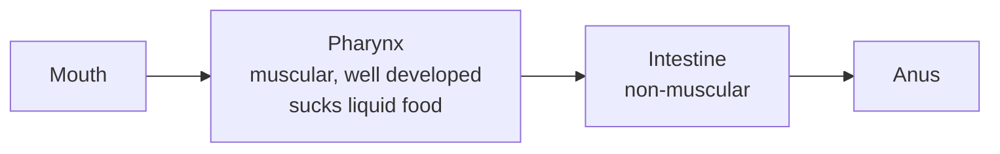
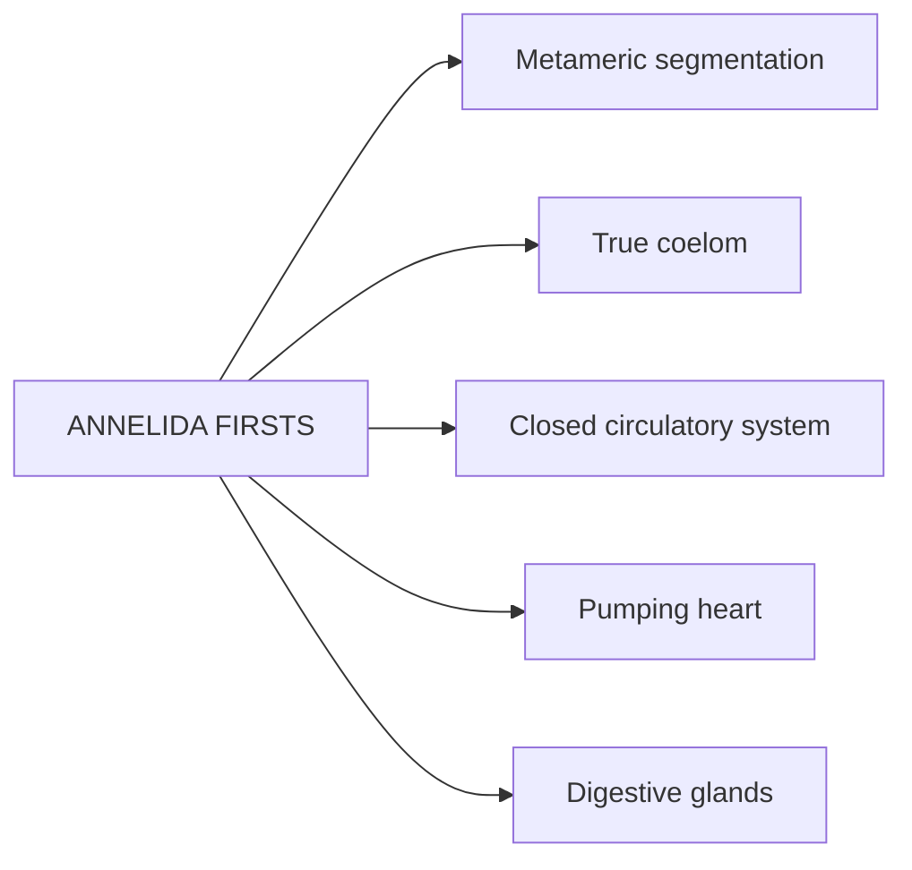
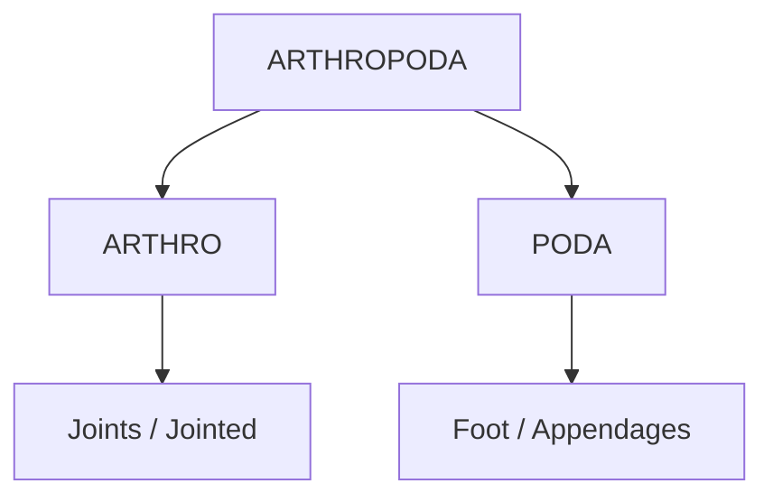
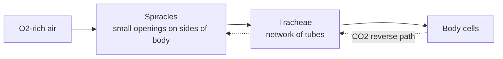
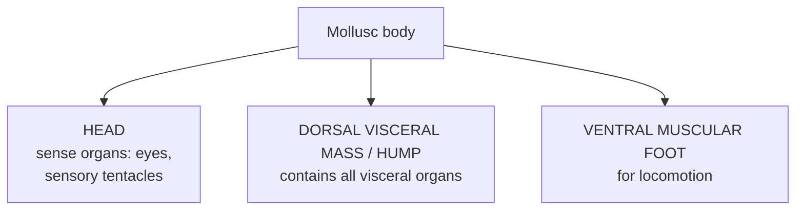
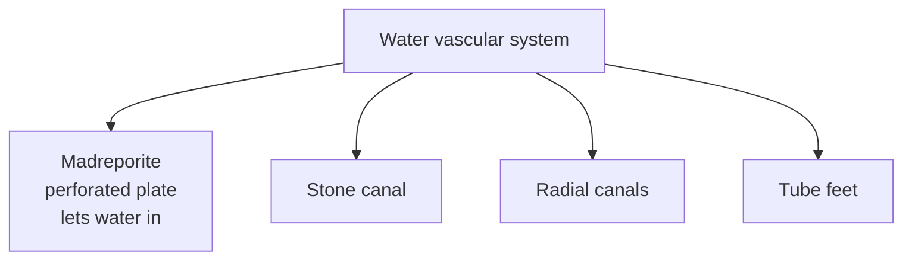
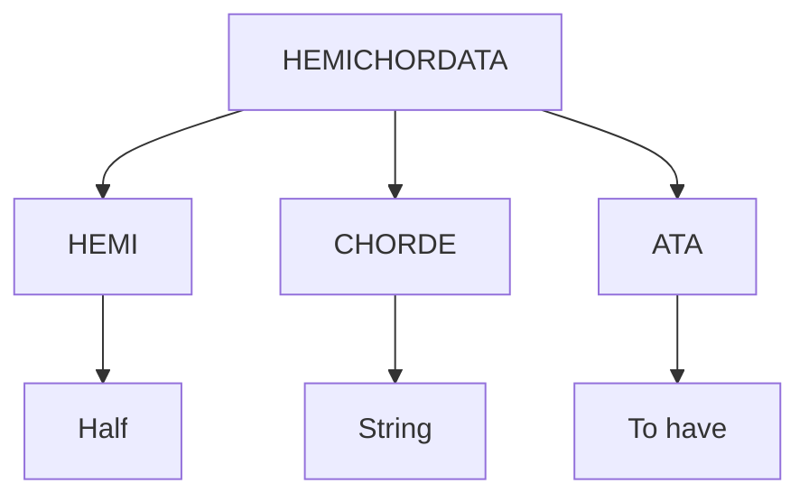
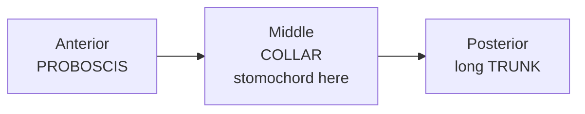
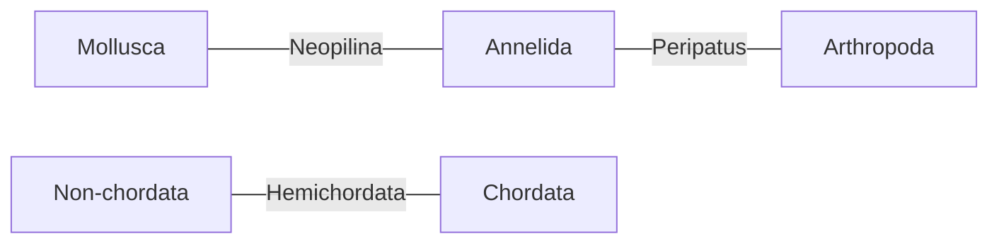

# 🪱 Animal Kingdom — Phyla 5 to 10

**Aschelminthes · Annelida · Arthropoda · Mollusca · Echinodermata · Hemichordata**

> Source: ALLEN NEET Biology, pages 235–250.
> Same content as the book, only rearranged and explained in simpler words.
> Lines marked 💬 explain what a word means.
> ⚠️ Platyhelminthes (phylum 4) pages were not in the photos, so it is not in this file.

---

# 5️⃣ PHYLUM ASCHELMINTHES / NEMATHELMINTHES

## 5.1 Why "Roundworms"?
- Body is **circular in cross section** and **tapering at both ends**, **without segmentation** → so called **Roundworms**.

## 5.2 General features

| Feature | Aschelminthes |
|---------|---------------|
| **Habit & habitat** | Nematodes are found **everywhere**; **free living** (aquatic & terrestrial) or **parasite** in plants and animals |
| **Shape** | Worm shaped, **long, cylindrical**, tapering ends |
| **Symmetry** | **Bilateral** |
| **Germ layers** | All 3 present → **Triploblastic** |
| **Level** | **Organ-system** level |
| **Head** | **No distinct head** → **Cephalisation absent** |
| **Body cavity** | **Pseudocoelomate** |
| **Skeleton** | **Absent** — but **hydroskeleton** present |

- 💬 *Cephalisation = having a distinct head.*

### Pseudocoel
- Body cavity is present **between body wall and digestive tract**, but it is **NOT lined by mesodermal epithelium** → called **Pseudocoel**.

### Hydroskeleton
- **Fluid pressure** in the pseudocoelom **maintains body shape** → called **Hydro skeleton**.

---

## 5.3 Body systems

### Digestive system — **complete**

| System | Aschelminthes |
|--------|---------------|
| **Respiration** | Through **body surface** by **diffusion** |
| **Circulatory system** | **Absent** |
| **Excretory system** | **H-shaped** (**Renette cell**); excretory canals (**Protonephridia**) remove body wastes from body cavity through **excretory pore**; they develop from an embryonic **Renette cell** |
| **Excretory matter** | **Ammonia** |
| **Nervous system** | **Nerve ring (Brain)** + **longitudinal nerve cords** (figure also shows cluster of nerve cells = ganglia) |

### 🧠 Remember
> **R**oundworm → **R**enette cell → shaped like the letter **H**

---

## 5.4 Reproduction
- Reproductive system is **developed**.
- Sexes are **separate** → **Dioecious** (male and female are distinct).
  - 💬 *Dioecious = male and female are different individuals.*
- Fertilisation → **Internal**.
- Development → **Direct or indirect**.

### Male vs Female *Ascaris* (figure)

| | ♂ Male *Ascaris* | ♀ Female *Ascaris* |
|--|-----------------|------------------|
| Length | **Less** | **More** |
| Posterior end | **Curved** | **Straight** |
| Special | **Penial setae** + **cloaca** at posterior end | — |

### 🧠 Remember
> **Male = small + curved tail** (like a hook) · **Female = long + straight tail**

---

## 5.5 Examples

| Name | Common name | Key point |
|------|-------------|-----------|
| ***Ascaris*** | **Roundworm** | Parasite of **small intestine** |
| ***Ancylostoma*** | **Hookworm** | Parasite of **small intestine** |
| ***Wuchereria*** | **Filarial worm** | **Viviparous**; digenetic parasite → **Filariasis / Elephantiasis**; adult infects **lymph vessels and lymph nodes** in humans; carrier host = **female mosquito** |
| ***Enterobius*** | **Pinworm / Seat worm** | Parasite of **large intestine** |

- 💬 *Viviparous = gives birth to young ones.*
- 💬 *Digenetic parasite = needs two hosts (here, human + mosquito).*
- Elephantiasis → inflammation (swelling) in **lower limbs** (figure).

### 🧠 Remember
- **A**scaris + **A**ncylostoma → **small** intestine ("**AA** = small")
- **E**nterobius → **E**nd part → **large** intestine
- **W**uchereria → **W**ithout eggs (viviparous) + **W**ide legs (elephantiasis)

---

## 5.6 Beginner's Box 5 (with answers from the content)

| Q | Question | Answer |
|---|----------|--------|
| 1 | Endoparasite of man that is viviparous? | ***Wuchereria*** |
| 2 | Pseudocoelomate animal? | ***Ascaris*** |
| 3 | *Ascaris* is found in? | **Alimentary canal** (small intestine) |
| 4 | Worm in diagram with **curved** posterior end? | **Male *Ascaris*** |
| 5 | *(partly hidden)* The pseudocoel... is found in? | **Aschelminthes** |
| 6 | Match: (p) *Ascaris* (q) *Wuchereria* (r) *Ancylostoma* (s) Tapeworm with (i) Hookworm (ii) Roundworm (iii) Flatworm (iv) Filaria worm | **p–ii, q–iv, r–i, s–iii** (the option number was hidden in the photo) |
| 7 | Incorrect statement about Aschelminthes? | **(3)** "Male and female united = hermaphrodite" ❌ → they are **dioecious** |
| 8 | Scientific name of pinworm? | ***Enterobius*** |

---
---

# 6️⃣ PHYLUM ANNELIDA

## 6.1 Why named so?
- Body surface is distinctly marked into **segments** or **metameres**.
- Latin **annulus = little ring** → so the name **Annelida**.
- Commonly called **segmented worms**.

## 6.2 General features

| Feature | Annelida |
|---------|----------|
| **Habit & habitat** | **Free living** in moist soil (terrestrial), fresh water or marine; **few are parasite** |
| **Body shape** | **Soft, elongated, cylindrical**; divided into segments (metameres) by ring-like grooves called **Annuli** |
| **Symmetry** | **Bilateral** |
| **Germ layers** | **Triploblastic** |
| **Level** | **Organ system** |
| **Body plan** | **Tube within tube** |
| **Segmentation** | **Metamerically segmented** |
| **Coelom** | **Coelomate** — filled with **coelomic fluid** that works as a **hydrostatic skeleton** |
| **Head** | Distinct head with sense organs in **few** annelids (e.g. ***Nereis***) |
| **Skeletal system** | **Absent**, but **hydrostatic skeleton** present |

## 6.3 Locomotion
- **Chitinous setae** and lateral muscular appendages called **Parapodia**.
- **Parapodia** are found in ***Nereis***.
- In some, **locomotory organs are absent** → e.g. **Leech**.

---

## 6.4 Body systems

| System | Annelida |
|--------|----------|
| **Digestive** | **Complete**, **straight**, extends through entire body; **digestive glands developed for the first time** in Annelida |
| **Respiration** | Through **moist skin** (**Cutaneous**); some have **gills** (**Branchial**) |
| **Circulatory** | **Closed type** (details below) |
| **Excretory organs** | **Nephridia** (sing. nephridium) = **coiled tubules**; also help in **osmoregulation**; some have **protonephridia** or **flame cells** |
| **Excretory matter** | **Ammonia** in aquatic forms · **Urea** in land forms |
| **Nervous** | **Nerve ring (Brain)** + **solid, double, ventral nerve cord** with **ganglia** |

### Circulatory system in detail
- **Closed type**.
- Heart is **neurogenic**.
- Some **blood vessels enlarge** to act as **pumping heart**.
- **Heart appears first time** in annelids.
- Blood is **red**, but **haemoglobin is dissolved in plasma** (**RBC absent**).

- 💬 *Neurogenic = heartbeat is started by nerves.*
- 💬 *Osmoregulation = keeping the right water–salt balance in the body.*

### 🧠 Remember respiration words
> **Cutaneous** = **cut**is/skin · **Branchial** = **bran**ch-like gills

---

## 6.5 Reproduction & development

| | ***Nereis*** | **Earthworm & Leech** |
|--|------------|----------------------|
| Sexes | **Dioecious** (separate) | **Monoecious** (both in one) |
| Development | **Indirect** — free-swimming ciliated **trochophore larva** | **Direct** |

- Reproduction is **sexual**.
- 💬 *Monoecious = male and female organs in the same individual.*

### 🧠 Remember
> ***N**ereis* = the "**N**ot normal" one → **dioecious**, **indirect**, **parapodia**, **distinct head**

---

## 6.6 ⭐ "FIRSTS" in Annelida

During evolution, these appeared **first** in annelids:

### 🧠 Mnemonic: "**S**ome **C**ool **C**ats **H**ave **G**lasses"
> **S**egmentation · true **C**oelom · **C**losed circulation · **H**eart · digestive **G**lands

---

## 6.7 Examples

| Name | Common name |
|------|-------------|
| ***Nereis*** | **Sandworm / Ringworm** |
| ***Pheretima*** | **Earthworm** |
| ***Hirudinaria*** | **Blood sucking leech / Fresh water leech** |
| ***Aphrodite*** | **Sea mouse** |

### 🧠 Remember
- **Hirud**inaria → **H**ungry for blood (leech)
- **P**heretima → **P**lain earthworm
- **Aphrodite** → a pretty name for a **sea mouse** 🐭

### NCERT Question
**Segmentation in body is first observed in?** → **(c) Annelida**

## 6.8 Beginner's Box 6

| Q | Question | Answer |
|---|----------|--------|
| 1 | Parapodia are locomotory structures in? | ***Nereis*** |
| 2 | Animals showing metameric segmentation? | **Annelids** |
| 3 | *Aphrodite* (sea mouse) is an? | **Annelid** |
| 4 | Correct for earthworm: segments, monoecious, nephridia? | **All of the above** |
| 5 | Paired ganglia connected by lateral nerves to double ___ in annelida | **Ventral nerve cord** |

---
---

# 7️⃣ PHYLUM ARTHROPODA

## 7.1 Why named so?

> **Arthropoda = animals with jointed appendages (legs).**

## 7.2 General features
- **Largest phylum** of Animalia; includes **insects**.
- **Over two-thirds** of named species on earth are arthropods.

### Habit & habitat
| Type | Example |
|------|---------|
| Aquatic (marine & fresh water) or terrestrial | — |
| Free living / sometimes **parasitic** | **Mosquito** |
| **Solitary** | **Centipede, Millipede** |
| **Colonial** | **Bee** |
| **Gregarious** | **Locust** |

- 💬 *Gregarious = lives and moves in large groups (swarms).*

| Feature | Arthropoda |
|---------|-----------|
| Symmetry | **Bilateral** |
| Germ layers | **Triploblastic** |
| Level | **Organ system** |
| Body plan | **Tube within tube** |
| Segmentation | **Metamerically segmented** |
| Coelom | **Coelomate** |
| Body regions | **Head, Thorax & Abdomen** |
| Some (Scorpion, Crab) | **Cephalothorax + Abdomen** (head + thorax fused) |

### ⭐ Unique features
1. **Jointed appendages** for different functions (arthro = jointed, poda = foot/appendages)
2. Body covered by **chitinous exoskeleton**

---

## 7.3 Respiration (4 types)

| Organ | Example | Group |
|-------|---------|-------|
| **Gills** | **Prawn** | Crustacea |
| **Book-gills** | **King crab** | — |
| **Tracheal system** | **Insects** (Cockroach) | Insecta |
| **Book-lungs** | **Scorpion** | Arachnida |

- **Trachea** carry **oxygen directly to the body cells**.

### 🧠 Remember
> **Book-gills** = king crab lives in **water** → **gills** · **Book-lungs** = scorpion lives on **land** → **lungs**

### Site of gaseous exchange in an insect — Tracheal system

- **Spiracles** = small openings on the sides of the insect's body.
- O₂ enters spiracles → tracheae → **diffuses into body cells**.
- CO₂ goes the **reverse path**: cells → tracheae → out through spiracles.

---

## 7.4 Other body systems

| System | Arthropoda |
|--------|-----------|
| **Circulatory** | **Open type** — blood flows in **open tissue spaces and haemocoel** instead of blood vessels |
| **Blood** | **Colourless** = **Haemolymph** (e.g. insect); **respiratory pigment absent** |
| **Haemocoel** | Body cavity around viscera contains blood; **coelom filled with blood = haemocoel** |
| **Digestive** | **Complete**; can feed on **all kinds of food** |
| **Excretory organs** | (i) **Antennary / green glands** → Prawn · (ii) **Coxal gland** → Scorpion · (iii) **Malpighian tubules** → Insects (open into gut) |
| **Excretory matter** | **Ammonia** in aquatic · **Uric acid** in land animals |
| **Nervous** | **Nerve ring** + **double, solid, ventral nerve cord** bearing **ganglia** (figure: brain, ventral nerve cord, segmental ganglia) |
| **Head** | **Distinct** → **high degree of cephalization** |
| **Sense organs** | **Simple eyes** or **compound eyes** or both, **antennae**, **statocyst**, **anal cerci** |

- 💬 *Viscera = internal organs.*
- 💬 *Statocyst = organ for body balance.*

### 🧠 Remember excretory organs: "**G**reen **P**rawn, **C**oxal **S**corpion, **M**alpighian **I**nsect" → **GP – CS – MI**

---

## 7.5 Reproduction & development
- **Mostly dioecious** (sexes separate).
- Fertilisation **usually internal**; **few aquatic** forms have **external**.
- **Gonads have ducts**.
- **Sexual dimorphism** may be present.
  - 💬 *Sexual dimorphism = male and female look different.*
- **Mostly oviparous** (few **viviparous**, e.g. **scorpion**).
- Development **direct or indirect**.

---

## 7.6 Most successful invaders of land (among invertebrates)
Because of:
1. **Cuticle** (chitinous exoskeleton)
2. **Appendages**
3. **Wings**

### 🧠 Remember: "**CAW**" 🐦 → **C**uticle, **A**ppendages, **W**ings

---

## 7.7 ⭐ Class comparison table

| Feature | Insecta | Arachnida | Crustacea |
|---------|---------|-----------|-----------|
| Body division | Head, Thorax, Abdomen | Cephalothorax + Abdomen | Cephalothorax + Abdomen |
| Respiration | **Tracheae** | **Book lungs** | **Gills** |
| Excretion | **Malpighian tubules** | **Coxal glands** | **Green glands** |
| Legs | **6** | **8** | **10** |
| Excretory waste | **Uric acid** | **Guanine** | **Ammonia** |
| Antennae | **1 pair** | **Absent** | **2 pairs** |
| Eyes | Compound | Simple | Compound |
| Example | Butterfly | Scorpion | Crab |

### 🧠 Remember
- **Legs: 6 → 8 → 10** (Insect → Spider/Scorpion → Crab), going up by 2
- **Antennae: 1 → 0 → 2**
- Arachnida is the "odd one": **no antennae**, **simple eyes**, **guanine**

---

## 7.8 Examples

| Type | Example |
|------|---------|
| **Gregarious pest** | ***Locusta*** (Locust) |
| **Living fossil** | ***Limulus*** (King crab) |
| **Connecting link** between Annelida & Arthropoda | ***Peripatus*** |
| **Wingless insect** | ***Lepisma*** — Silver fish (book louse / book worm) |
| **Others** | Butterfly, Scorpion, Prawn, Spider, Centipede, Millipede |

### Vectors (disease carriers)

| Vector | Disease |
|--------|---------|
| ***Anopheles*** (mosquito) | **Malaria** |
| ***Aedes*** (mosquito) | **Dengue** |
| ***Culex*** (mosquito) | **Elephantiasis** |
| ***Glossina*** | **Sleeping sickness** |
| **Sand-fly** | **Leishmaniases** |

### 🧠 Mosquito trick: "**A M**an, **A D**og, **C E**at"
> **A**nopheles → **M**alaria · **A**edes → **D**engue · **C**ulex → **E**lephantiasis
> ***Gl**ossina* → "**Gl**um / sleepy" → **sleeping sickness**

> 🔗 Link with Aschelminthes: Elephantiasis is caused by ***Wuchereria*** and carried by ***Culex*** (female mosquito).

### Economically important insects

| Name | Common name |
|------|-------------|
| ***Apis*** | Honey bee |
| ***Bombyx*** | Silk worm |
| ***Laccifer*** | Lac insect |

### 🧠 Remember: "**ABL**e" → **A**pis (honey), **B**ombyx (silk), **L**accifer (lac)

---

## 7.9 NCERT Question
**Why do arthropods form the largest group of the animal kingdom?**
- **(a) Chitinous exoskeleton** → gives **protection**, **reduces water loss**, so they are more **adapted to land**.
- **(b) Jointed appendages** → give **motility** (movement).

## 7.10 Beginner's Box 7

| Q | Question | Answer |
|---|----------|--------|
| 1 | Green glands are found in? | **Crustaceans** |
| 2 | Arthropoda is characterised by? | **(4)** Chitinous exoskeleton, metameric segmentation and paired jointed appendages |
| 3 | Excretion in arthropods by? | **All of the above** (Malpighian tubules, green glands, coxal glands) |
| 4 | Book-lungs are found in? | **Scorpion** |

---
---

# 8️⃣ PHYLUM MOLLUSCA

## 8.1 General features
- **Second largest phylum**; includes **"soft bodied and shelled"** animals.

| Feature | Mollusca |
|---------|----------|
| Habitat | **Aquatic** (marine or fresh water) or **terrestrial** |
| Symmetry | **Bilateral**; few are **secondarily asymmetrical** (**snail**) due to **twisting / torsion** during growth |
| Germ layers | **Triploblastic** |
| Coelom | **Coelomate** (but coelom is **greatly reduced**) |
| Level | **Organ system** |
| Segmentation | **Unsegmented** — ***Neopilina*** is **exceptionally segmented** |
| Covering | **Calcareous shell**; variety of shapes |

> 🔗 Link with first file: this is why **snail** is called **asymmetrical**.

---

## 8.2 Body = 3 parts

### Mantle & shell
- **Soft, spongy layer of skin** over the visceral hump = **Mantle** or **Pallium**.
- Space **between hump and mantle** = **Mantle cavity**.
- Mantle usually **secretes an external calcareous shell**.
- Shell made of **calcium carbonate + chitin**.

### 🧠 Remember
> **Hump** (organs) → covered by **Mantle** (skin blanket) → which makes the **Shell** (house)

---

## 8.3 Body systems

| System | Mollusca |
|--------|----------|
| **Digestive** | **Complete**; buccal cavity has **Radula** — a **file-like rasping organ** with **transverse rows of teeth** for feeding; **anus opens into mantle cavity**; digestive gland = **Hepatopancreas** |
| **Respiration** | **Feather-like gills = Ctenidia** in mantle cavity (also help in **excretion**) |
| ***Pila*** | **Pulmonary sac** on land, **gills** in water |
| **Circulatory** | **Open type**; **dorsal pulsatile heart** + few **arteries** that open into **sinuses** |
| **Haemocoel** | Coelom greatly reduced; spaces among viscera contain blood → **haemocoel** |
| **Excretory organs** | **1 or 2 pairs** of **Keber's organs** / **Organ of Bojanus** → open into **mantle cavity** |
| **Excretory matter** | **Ammonia** in aquatic · **Uric acid** in terrestrial |
| **Nervous** | **3 or 4 pairs of ganglia** |

- 💬 *Rasping = scraping, like a file scraping wood.*

### Sense organs

| Organ | Job |
|-------|-----|
| **Eye** | On a stalk called **ommatophore** (in some molluscs) |
| **Statocyst / Lithocyst** | **Body equilibrium** (balance); located **in foot** |
| **Osphradium** | **Chemoreceptor / olfactory receptor** → tests **chemical nature of water (pH)** |

### 🧠 Remember
- **R**adula → **R**asp (scraper with teeth)
- **K**eber's / **B**ojanus → **K**idney of mollusc (figure labels it kidney)
- **Os**phradium → "**Os**mell" water → pH test
- **Omma**tophore → **Omma** = eye stalk

---

## 8.4 Reproduction
- Usually **dioecious**.
- Mostly **oviparous**.
- Fertilisation → **external or internal**.
- Development → **mostly indirect**.

## 8.5 Body plan figure labels
Head, Mouth, Radula, Mantle (Pallium), Hepatopancreas, Stomach, Heart, Shell, Visceral hump, Intestine, Osphradia, Haemocoel, Kidney, Anus, Mantle cavity, Gill (ctenidium), Muscular foot, Statocyst.

---

## 8.6 Examples

| Name | Common name |
|------|-------------|
| ***Pila*** | **Apple snail** |
| ***Pinctada*** | **Pearl oyster** |
| ***Sepia*** | **Cuttle fish** |
| ***Loligo*** | **Squid** |
| ***Dentalium*** | **Tusk shell** |
| ***Octopus*** | **Devil fish** |
| ***Aplysia*** | **Sea hare** |
| ***Chaetopleura*** | **Chiton** |
| ***Neopilina*** | **Connecting link** between Mollusca & Annelida |

### 🧠 Pair tricks
- **Pin**ctada → **Pin** a **pearl**
- **Dent**alium → **Dent** = tooth → **tusk**
- **Aply**sia → **A** sea **hare**
- **Lol**igo → **Lol**, a **squid**
- **Sep**ia → **Se**a **cuttle** → **cuttle fish** (fish name, but a mollusc!)
- **Octopus** → **devil fish** (also not a fish!)
- **Chaeto**pleura → **Chi**ton
- **Neo**pilina → "**new** link" → segmented mollusc → links to **Annelida**

> ⚠️ Fish-named molluscs: **Cuttle fish, Devil fish** — NOT fish.

### ⚠️ "Sea ___" trap (all different phyla)
| Name | Phylum |
|------|--------|
| **Sea hare** (*Aplysia*) | **Mollusca** |
| **Sea mouse** (*Aphrodite*) | **Annelida** |

## 8.7 Beginner's Box (visible questions)

| Q | Question | Answer |
|---|----------|--------|
| 4 | Which is a mollusc: sea-horse, sea-mouse, sea-hare, *Limulus*? | **Sea-hare** |
| 5 | NOT a feature of Mollusca? | **(3) Radially symmetrical** ❌ (they are bilateral) |
| 6 | Mollusc called "tusk shell"? | ***Dentalium*** |
| 7 | File-like rasping organ in mouth? | **Radula** |

---
---

# 9️⃣ PHYLUM ECHINODERMATA

## 9.1 Why named so?
> **Echino = spiny · derma = skin · ata = to have** → **Spiny-skinned animals**

## 9.2 General features

| Feature | Echinodermata |
|---------|--------------|
| Habitat | **Exclusively marine**; generally live at **bottom of sea**; **slow moving** |
| Shape | **Star** (Star fish), **Cylindrical** (*Holothuria*), **Melon** (Sea urchin), **Flower** (Sea lily) |
| Symmetry | **Adult = radial**, **Larva = bilateral** |
| Germ layers | **Triploblastic** |
| Coelom | **True coelom** (coelomate) |
| Level | **Organ system** |
| Head | **No distinct head** |
| Body plan | **Tube within tube** |

### Skin & skeleton
- Skin has **calcareous spines** and **pedicellariae**.
- **Endoskeleton** = **calcareous plates / dermal ossicles**.
- **Pedicellariae** = **minute pincer-like** structures that come out through skin → **keep body surface clear of debris**.
  - 💬 *Pincer = like tweezers.*

---

## 9.3 ⭐ Water Vascular System (Ambulacral system)
- **The most distinctive feature** of echinoderms.
- Water-filled system with **tube feet**.

**Parts:** **Madreporite** (perforated plate, lets water in), **stone canal**, **radial canals**, **tube feet**.

**Tube feet help in 4 jobs:**

| Job |
|-----|
| **Locomotion** |
| **Capture of food** |
| **Transport of food** |
| **Respiration** |

### 🧠 Remember: "**L**ittle **C**rabs **T**ake **R**ides" → **L**ocomotion, **C**apture, **T**ransport, **R**espiration

---

## 9.4 Body systems

| System | Echinodermata |
|--------|--------------|
| **Digestive** | **Complete**; **mouth on lower side (ventral)**, **anus on upper side (dorsal)** |
| **Respiration** | **Body surface or gills** |
| **Circulatory** | **Reduced, open type**; **no heart or pumping vessel** |
| **Excretory** | **No excretory system**; **ammonia diffuses out** through body surface |
| **Nervous** | **Simple, less developed** |
| **Reproduction** | **Sexual**; sexes **separate** (unisexual) |
| **Fertilisation** | **Usually external** |
| **Development** | **Indirect**, free-swimming larva (e.g. **Bipinnaria larva**) |

### 🧠 Remember
- **No heart · No excretory system** → "**N**o **H**eart, **N**o **E**xcretion" = "**NH-NE**"
- **Mouth DOWN, Anus UP** → opposite of what you'd expect

---

## 9.5 Examples

| Name | Common name |
|------|-------------|
| ***Cucumaria / Holothuria*** | **Sea cucumber** |
| ***Antedon*** | **Sea lily** |
| ***Asterias*** | **Star fish** |
| ***Echinus*** | **Sea urchin** |
| ***Ophiura*** | **Brittle star** |

### 🧠 Pair tricks
- **Aster**ias → **Aster** = star → **star fish**
- **Echin**us → **Echin** = spiny → spiky **sea urchin**
- **Cucum**aria → **cucum**ber
- **Ante**don → **An**tique flower → **sea lily**
- **Oph**iura → "**Oh**, it broke!" → **brittle star**

> ⚠️ Star **fish** = NOT a fish (Echinodermata).

### NCERT Question
**Water vascular system is characteristic of?** → **(c) Echinodermata**

---
---

# 🔟 PHYLUM HEMICHORDATA

## 10.1 Status
- **Connecting link** between **Non-chordata & Chordata**.
- Earlier a **subphylum under Chordata**; **now a separate phylum under Non-chordata**.

## 10.2 Why named so?

> **Hemichordata = "having half a string"** → half a notochord (the stomochord).

## 10.3 General features

| Feature | Hemichordata |
|---------|-------------|
| Group | **Small group** of **worm-like marine** animals |
| Level | **Organ system** |
| Symmetry | **Bilateral** |
| Germ layers | **Triploblastic** |
| Coelom | **Coelomate** |
| Body | **Cylindrical, unsegmented** |
| Digestive | **Complete** |
| Stomochord | **Rudimentary** structure in **collar region**, similar to notochord |
| Post-anal tail | **Absent** |
| Respiration | **Gills** |
| Circulatory | **Open type**; blood **colourless** with **amoeboid corpuscles**; respiratory pigment **vanadium** in some; **heart dorsal** |
| Excretion | Single **glomerulus** or **proboscis gland** |
| Nervous | CNS just like **non-chordates** |
| Reproduction | **Sexual**, mostly **unisexual** |
| Fertilisation | **External** |
| Development | **Indirect** with **Tornaria larva** |

- 💬 *Rudimentary = small, not fully developed.*

### Body = 3 parts

### 🧠 Remember: "**P**lease **C**all **T**om" → **P**roboscis, **C**ollar, **T**runk
### 🧠 Remember larvae: **T**ornaria → **T**ongue worm (*Balanoglossus*)

---

## 10.4 Examples

| Name | Common name |
|------|-------------|
| ***Balanoglossus*** | **Tongue worm / Acorn worm** |
| ***Saccoglossus*** | — |

### 🧠 Remember
> **-glossus** = tongue → both examples end in **glossus**

---
---

# ⚖️ MASTER COMPARISON — Phyla 5 to 10

| Feature | Aschelminthes | Annelida | Arthropoda | Mollusca | Echinodermata | Hemichordata |
|---------|--------------|----------|-----------|----------|--------------|-------------|
| Common name | Roundworms | Segmented worms | — | Soft bodied & shelled | Spiny skinned | — |
| Habitat | Everywhere | Soil, fresh water, marine | Aquatic or terrestrial | Aquatic or terrestrial | **Exclusively marine** | Marine |
| Symmetry | Bilateral | Bilateral | Bilateral | Bilateral (snail asym.) | **Adult radial, larva bilateral** | Bilateral |
| Coelom | **Pseudo** | True | True (haemocoel) | Reduced (haemocoel) | True | True |
| Segmentation | ❌ | ✅ Metameric | ✅ Metameric | ❌ (*Neopilina* ✅) | — | ❌ |
| Head | ❌ Absent | Few (*Nereis*) | ✅ High cephalization | ✅ Head | ❌ | — |
| Skeleton | Hydroskeleton | Hydrostatic | Chitinous exoskeleton | Calcareous shell | Calcareous endoskeleton | — |
| Respiration | Body surface | Skin / gills | Gills, book gills, trachea, book lungs | Ctenidia (gills) | Body surface / gills | Gills |
| Circulation | **Absent** | **Closed** | Open | Open | Open, **no heart** | Open |
| Heart | — | Neurogenic, first time | — | Dorsal pulsatile | **No heart** | Dorsal |
| Blood | — | Red, Hb in plasma, no RBC | Colourless haemolymph, no pigment | — | — | Colourless, vanadium in some |
| Excretory organ | Renette cell (H-shaped) | Nephridia | Green glands, coxal glands, Malpighian tubules | Keber's organ / Organ of Bojanus | **None** | Glomerulus / proboscis gland |
| Excretory matter | Ammonia | Ammonia (water), urea (land) | Ammonia (water), uric acid (land) | Ammonia (water), uric acid (land) | Ammonia | — |
| Nervous | Nerve ring + longitudinal cords | Nerve ring + double ventral cord | Nerve ring + double ventral cord | 3–4 pairs ganglia | Simple | Like non-chordates |
| Sexes | Dioecious | *Nereis* dioecious; earthworm, leech monoecious | Mostly dioecious | Usually dioecious | Separate | Mostly unisexual |
| Fertilisation | Internal | — | Usually internal | External or internal | Usually external | External |
| Development | Direct or indirect | Direct or indirect (trochophore) | Direct or indirect | Mostly indirect | Indirect (bipinnaria) | Indirect (tornaria) |

> "—" = not mentioned in these pages.

---

## 🔗 Connecting links

| Connecting link | Between |
|-----------------|---------|
| ***Peripatus*** | Annelida & Arthropoda |
| ***Neopilina*** | Mollusca & Annelida |
| **Hemichordata** (phylum) | Non-chordata & Chordata |

---

## 🐛 Larvae

| Larva | Phylum | Example |
|-------|--------|---------|
| **Trochophore** (free-swimming, ciliated) | Annelida | *Nereis* |
| **Bipinnaria** | Echinodermata | — |
| **Tornaria** | Hemichordata | — |

### 🧠 "**T**he **B**ig **T**hree" → **T**rochophore (Annelida) → **B**ipinnaria (Echino) → **T**ornaria (Hemi) — same order as the phyla.

---

## 🩸 Excretory organs — one view

| Organ | Who has it |
|-------|-----------|
| **Renette cell** (H-shaped) | Aschelminthes |
| **Nephridia** | Annelida |
| **Protonephridia / flame cells** | Some annelids; Aschelminthes canals = protonephridia |
| **Green / antennary glands** | Prawn (Crustacea) |
| **Coxal glands** | Scorpion (Arachnida) |
| **Malpighian tubules** | Insects |
| **Keber's organ / Organ of Bojanus** | Mollusca |
| **None** | Echinodermata |
| **Glomerulus / proboscis gland** | Hemichordata |

---

## 🐾 Common names that trick you

| Name | Actually is | Phylum |
|------|-------------|--------|
| Ringworm (*Nereis*) | Sandworm | Annelida |
| Sea mouse (*Aphrodite*) | Worm | Annelida |
| Silver fish (*Lepisma*) | Wingless insect | Arthropoda |
| King crab (*Limulus*) | Living fossil | Arthropoda |
| Cuttle fish (*Sepia*) | Mollusc | Mollusca |
| Devil fish (*Octopus*) | Mollusc | Mollusca |
| Sea hare (*Aplysia*) | Mollusc | Mollusca |
| Star fish (*Asterias*) | Echinoderm | Echinodermata |
| Tongue / Acorn worm (*Balanoglossus*) | Hemichordate | Hemichordata |

---

# ⚠️ Exam Traps — Checklist

- [ ] **Only Aschelminthes** = pseudocoelomate; **no circulatory system**
- [ ] Aschelminthes pharynx = **muscular**, intestine = **non-muscular**
- [ ] Male *Ascaris* = **shorter, curved tail, penial setae**
- [ ] *Wuchereria* = **viviparous**, lymph vessels, carried by **female mosquito (Culex)**
- [ ] *Enterobius* = **large** intestine; *Ascaris*, *Ancylostoma* = **small** intestine
- [ ] Annelida firsts: **segmentation, true coelom, closed circulation, pumping heart, digestive glands**
- [ ] Annelid blood = **red**, **haemoglobin in plasma**, **no RBC**; heart **neurogenic**
- [ ] Parapodia → ***Nereis***; no locomotory organs → **Leech**
- [ ] Earthworm & leech = **monoecious**, **direct**; *Nereis* = **dioecious**, **trochophore**
- [ ] Arthropoda = **largest** phylum (>2/3 species); Mollusca = **second largest**
- [ ] Arthropod blood = **colourless haemolymph**, **no respiratory pigment**
- [ ] Book gills = **king crab**; book lungs = **scorpion**
- [ ] Green glands = **prawn**; coxal = **scorpion**; Malpighian = **insects**
- [ ] Scorpion = **viviparous** arthropod
- [ ] Arachnida: **8 legs, no antennae, simple eyes, guanine**
- [ ] *Culex* → elephantiasis; *Aedes* → dengue; *Anopheles* → malaria; *Glossina* → sleeping sickness
- [ ] Radula = **file-like rasping organ**; Osphradium = tests **pH of water**
- [ ] Mollusc anus opens into **mantle cavity**; shell = **CaCO₃ + chitin**
- [ ] Snail = **secondarily asymmetrical** (torsion)
- [ ] Echinoderm: **no heart, no excretory system**; mouth **ventral**, anus **dorsal**
- [ ] Madreporite = **entry of water** into water vascular system
- [ ] Hemichordata = **non-chordate**; stomochord in **collar**; **no post-anal tail**; **tornaria** larva
- [ ] Vanadium pigment → **Hemichordata**
