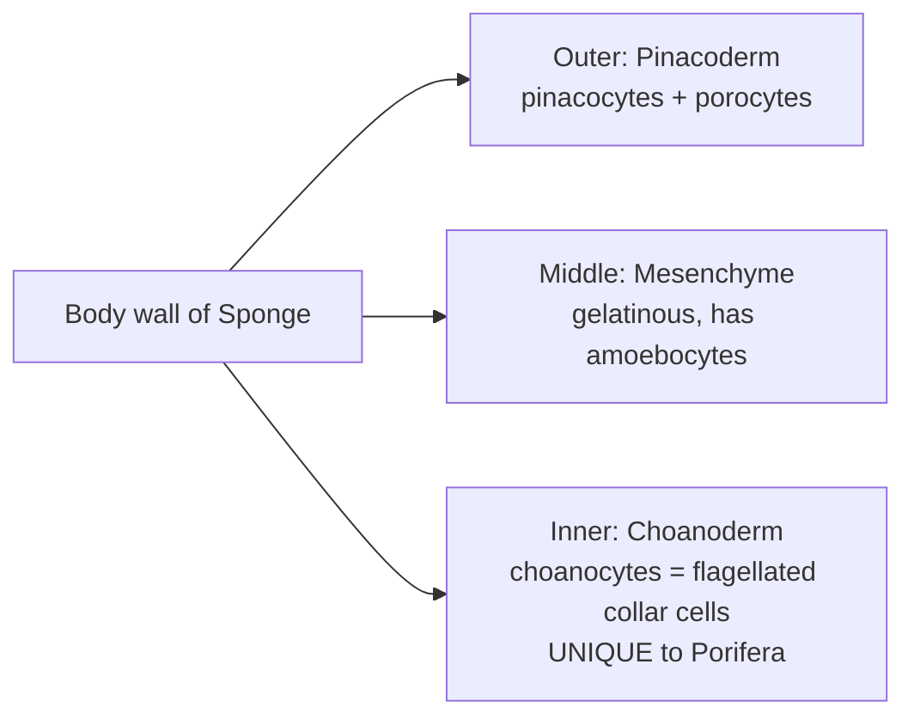
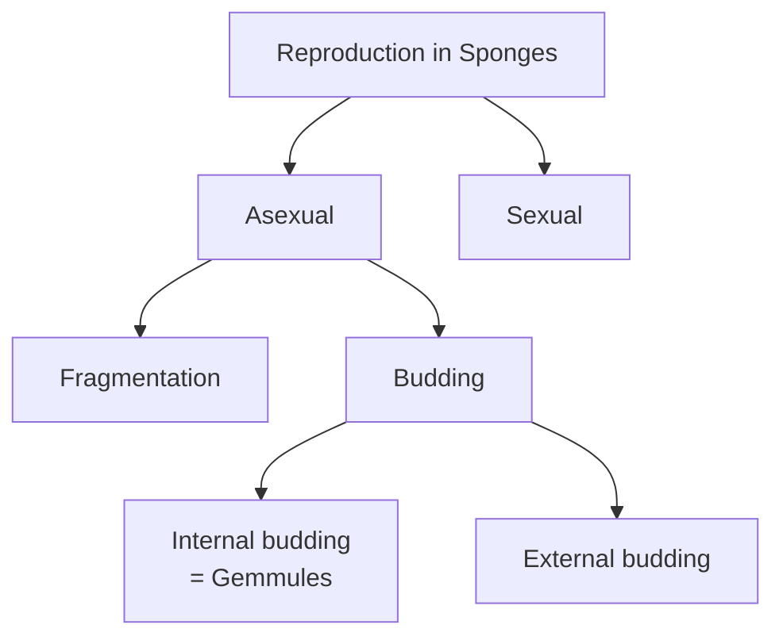
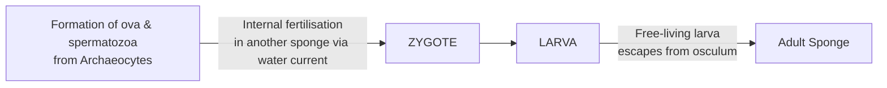
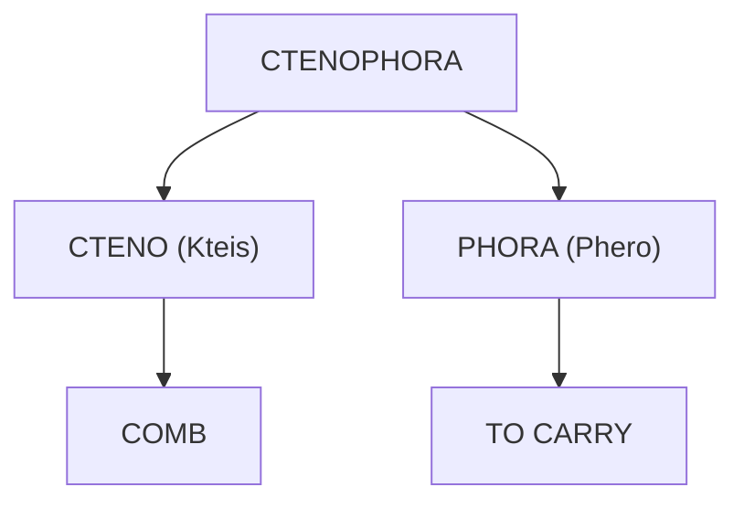

# 🧽 Animal Kingdom — Phyla 1, 2 & 3

**Porifera · Cnidaria (Coelenterata) · Ctenophora**

> Source: ALLEN NEET Biology, pages 224–230.
> Same content as the book, only rearranged and explained in simpler words.
> Lines marked 💬 explain what a word means.

---

# 1️⃣ PHYLUM PORIFERA (Sponges)

## 1.1 General features

- Commonly known as **"Sponges"**.
- All are **aquatic** and **sessile**.
  - 💬 *Sessile = fixed at one place, cannot move around.*
- **Mostly marine**, but a few live in **fresh water** → e.g. ***Spongilla***.
- They can be **solitary** (alone) or **colonial** (in groups).
- Body has many pores:
  - Many **small pores = Ostia** → water **enters**
  - **One large opening = Osculum** → water **exits**
- Body forms and shapes vary; **most are irregular → asymmetrical**.
  - **Radial symmetry** in ***Sycon*** and ***Leucosolenia***.
- **Primitive multicellular**, **acoelomate**, **cellular level of organisation**.

### 🧠 Remember
> **O**stia = **O**pen-in (small, many) · **O**sculum = **O**ut (big, one)

---

## 1.2 Body wall (3 parts)

| Layer | Name | Made of |
|------|------|---------|
| Outer | **Pinacoderm** | **Pinacocytes** and **porocytes** |
| Middle | **Mesenchyme** | **Gelatinous** material with **amoebocyte** cells |
| Inner | **Choanoderm** | **Choanocytes** = **flagellated collar cells** ⭐ *unique characteristic of Porifera* |

### Amoebocyte cells in mesenchyme

| Cell | Job |
|------|-----|
| **Scleroblasts** | Form **skeleton elements** |
| **Archaeocytes** | **Totipotent** cells → form **ova & spermatozoa** |

- 💬 *Totipotent = can become any type of cell.*

### 🧠 Remember (outside → inside): **P – M – C**
> **P**inacoderm → **M**esenchyme → **C**hoanoderm
> "**P**lease **M**ake **C**offee"

---

## 1.3 Spongocoel & Canal system

- Body wall encloses a **large central cavity** = **Spongocoel** or **Paragastric cavity**, with **small hollow canals**.

### Canal system / Water transport system
- ⭐ **Unique feature of sponges.**
- Water path:

- This water pathway helps in **3 things**:

| Job | Meaning |
|-----|---------|
| **Food gathering** | Nutrition |
| **Respiratory exchange** | Breathing (gases) |
| **Removal of wastes** | Excretion |

### 🧠 Remember: water brings **F**ood, **R**espiration, **E**xcretion → "**FRE**sh water"

---

## 1.4 Physiology (body functions)

| Function | How it happens in Porifera |
|----------|---------------------------|
| **Respiration & excretion** | By **diffusion of gases through body surface** |
| **Excretory matter** | **Ammonia** |
| **Water current** | **Choanocytes** line the **spongocoel and canals**; **ceaseless beating of their flagella** keeps water flowing |
| **Nutrition** | **Holozoic** |
| **Digestion** | **Intracellular** — in **food vacuoles of choanocytes** |

- 💬 *Holozoic = takes in food (like animals do).*
- 💬 *Intracellular = digestion happens inside the cell.*

### Structure of a choanocyte (from figure)
- **Flagellum** · **Collar** · **Nucleus** · **Food vacuoles**

---

## 1.5 Skeleton

- **Internal** skeleton, located in the **mesenchyme**.
- Made of any of these:
  - tiny **calcareous spicules**, or
  - **siliceous spicules**, or
  - fine **spongin fibres**

| Secreted by | Makes |
|-------------|-------|
| **Scleroblast** | **Spicules** |
| **Spongioblast** | **Spongin fibres** |

### 🧠 Remember
> **Scler**oblast → **S**picules · **Spongi**oblast → **Spongi**n

---

## 1.6 Reproduction

### (A) Asexual
- By **budding**, **fragmentation**, or by special cell mass **gemmules** containing **archaeocytes**.
- **Gemmules** = **endogenous buds** of asexual reproduction → formed in **unfavourable condition**.
  - 💬 *Endogenous = formed inside.*

**Steps of external budding (figure):**
1. Outgrowth arises at the **base**
2. Bud **increases in size**
3. Bud may **remain attached** to the parent
4. Bud may **break out** from the parent and get attached to a **new substratum**

### (B) Sexual
- Sponges are **hermaphrodite**.
  - 💬 *Hermaphrodite = one individual makes both ova and sperms.*
- Fertilisation is **internal** and **cross**, due to **protogynous condition**.
  - 💬 *Cross = sperm of one sponge fertilises ovum of another sponge.*
- Development is **indirect** → has a **larval stage** that looks different from the adult.

---

## 1.7 Examples

| Name | Common name |
|------|-------------|
| ***Euspongia*** | **Bath sponge** |
| ***Euplectella*** | **Venus flower basket** |
| ***Sycon*** | ***Scypha*** |
| ***Cliona*** | **Boring sponge** — ⚠️ **harmful to oyster industry** |
| ***Spongilla*** | Freshwater sponge (from 1.1) |
| ***Leucosolenia*** | Radial sponge (from 1.1) |

### 🧠 Remember examples: "**E**very **E**vening **S**ponges **C**lean"
> **E**uspongia · **E**uplectella · **S**ycon · **C**liona

---

## ⭐ Porifera — One-look summary

| Feature | Porifera |
|---------|----------|
| Habitat | Aquatic, mostly marine (*Spongilla* fresh water) |
| Lifestyle | Sessile; solitary or colonial |
| Symmetry | Mostly asymmetrical (*Sycon, Leucosolenia* radial) |
| Level | Cellular |
| Coelom | Acoelomate |
| Unique 1 | **Choanocytes** (collar cells) |
| Unique 2 | **Canal system** (water transport) |
| Water in / out | Ostia / Osculum |
| Central cavity | Spongocoel (paragastric cavity) |
| Respiration, excretion | Diffusion through body surface |
| Excretory matter | Ammonia |
| Nutrition | Holozoic |
| Digestion | Intracellular (food vacuoles of choanocytes) |
| Skeleton | Spicules (calcareous/siliceous) or spongin fibres |
| Asexual | Fragmentation, budding, gemmules |
| Sexual | Hermaphrodite, internal + cross fertilisation |
| Development | Indirect (larva) |

---
---

# 2️⃣ PHYLUM CNIDARIA / COELENTERATA

## 2.1 Why two names?

| Name | Because of |
|------|------------|
| **Cnidaria** | Stinging cells called **Cnidoblasts** or **Cnidocytes** |
| **Coelenterata** | **Gastrovascular cavity** or **Coelenteron** |

### 🧠 Remember
> **Cnid**aria → **Cnid**oblast (sting) · **Coelentera**ta → **Coelentero**n (cavity)

---

## 2.2 General features

- **Mostly marine**, few **fresh-water** (***Hydra***).
- **Carnivorous**.
- **Sessile or free swimming**.
- **Radially symmetrical**.
- **Tissue level** of organisation, **acoelomate**.
- **Diploblastic** → 2 germinal layers: **outer ectoderm** + **inner endoderm**, with **mesoglea** between them.
- Body of **some** coelenterates is covered by an **exoskeleton of calcium carbonate** → e.g. **Corals**.

---

## 2.3 Cnidoblast / Cnidocyte

- Contains a **stinging capsule** = **Nematocyst**.
- Present on the **tentacles and body**.
- Used for **3 things**:

| Use | Meaning |
|-----|---------|
| **Anchorage** | Attachment |
| **Defence** | Protection |
| **Capture of prey** | Offence |

**Parts (from figure):** **Flagellum · Cnidocil · Operculum (lid) · Nucleus**

### 🧠 Remember the 3 uses: **"ADC"** → **A**nchorage, **D**efence, **C**apture

---

## 2.4 Coelenteron & digestion

- A large central cavity = **Coelenteron**.
- Has a **single opening** = **mouth on hypostome**.
  - → **Incomplete digestive tract** = **Blind sac** body plan.
- Coelenteron also **distributes food**, besides **partly digesting** it.

### Nutrition in *Hydra* (figure)

### Digestion = BOTH types

| Type | Where |
|------|-------|
| **Extracellular** | In the **coelenteron** |
| **Intracellular** | In the **food vacuole** |

### T.S. of Coelenterate (labels, outside → inside)
**Ectoderm → Mesogloea → Endoderm → Gastrodermal cells → Gastrovascular cavity**

---

## 2.5 Respiration, excretion & nervous system

- **Respiration and excretion** → by **diffusion of gases through body surface**.
  - O₂ goes **in**; CO₂ and ammonia go **out** (figure).
- **Excretory matter** = **Ammonia**.
- **Nervous system** = **diffuse type**, made of **non-polar neurons** → called **Nerve net**.

---

## 2.6 Two body forms — Polyp & Medusa (Dimorphic)

- 💬 *Dimorphic = two forms.*

| | 🌿 Polyp | ☂️ Medusa |
|--|---------|----------|
| Shape | **Cylindrical** | **Umbrella shaped** |
| Movement | **Sessile** | **Free swimming** |
| Living | **Solitary or colonial** | **Always solitary** |
| Mouth & tentacles | Directed **upwards** | Directed **downwards** |
| Form type | **Asexual** form | **Sexual** form |
| Example | ***Hydra, Adamsia*** | ***Aurelia*** |

### 🧠 Remember
> **P**olyp = **P**illar (cylinder, fixed, faces **up**, asexual)
> **M**edusa = **M**ushroom/umbrella (floats, faces **down**, sexual)

---

## 2.7 Metagenesis (Alternation of generation)

- Shown by **some** cnidarians.
- **Polyps produce medusae asexually**, and **medusae form polyps sexually**.
- e.g. ***Obelia, Physalia***

> ⚠️ **Note:** Metagenesis is **ABSENT** in ***Hydra, Adamsia*** and ***Aurelia***.

### 🧠 Remember
> **Polyp → Medusa = Asexual** ("**P**olyp **A**lways **A**sexual") — matches the table: polyp is the asexual form.
> **Has** metagenesis: **O**belia, **P**hysalia → "**OP**"
> **No** metagenesis: **H**ydra, **A**damsia, **A**urelia → "**HAA**"

---

## 2.8 Reproduction

- **Asexual** → by **budding**
- **Sexual** → by **production of gametes**
- **Development** → **indirect** with **larval stages**

---

## 2.9 Examples

| No. | Name | Common name |
|-----|------|-------------|
| (i) | ***Hydra*** | **Fresh water polyp** |
| (ii) | ***Obelia*** | **Sea fur** |
| (iii) | ***Pennatula*** | **Sea pen** |
| (iv) | ***Physalia*** | **Portuguese man of war** |
| (v) | ***Gorgonia*** | **Sea fan** |
| (vi) | ***Adamsia*** | **Sea anemone** |
| (vii) | ***Aurelia*** | **Jelly fish** |
| (viii) | ***Meandrina*** | **Brain coral** |

### 🧠 Pair trick (Latin name ↔ common name)
- **Pen**natula → Sea **pen**
- **Gorgon**ia → Sea **fan** (a gorgon waving a fan)
- **Meandr**ina → **Brain** coral (brain has winding "meanders")
- **Obel**ia → Sea **fur**
- **Phys**alia → **Portuguese man of war**
- **Adam**sia → Sea **anemone** (**A**damsia–**A**nemone)
- **Aur**elia → **Jelly** fish
- **Hydr**a → **Fresh water** polyp (hydra = water)

---

## ⭐ Cnidaria — One-look summary

| Feature | Cnidaria |
|---------|----------|
| Habitat | Mostly marine, few fresh water (*Hydra*) |
| Lifestyle | Sessile or free swimming |
| Food habit | Carnivorous |
| Symmetry | Radial |
| Level | Tissue |
| Coelom | Acoelomate |
| Germ layers | Diploblastic (mesoglea between) |
| Exoskeleton | Calcium carbonate in some (Corals) |
| Special cell | **Cnidoblast** with **nematocyst** |
| Cavity | Coelenteron (gastrovascular cavity) |
| Opening | Single — mouth on hypostome (blind sac) |
| Digestion | Extracellular + intracellular |
| Respiration, excretion | Diffusion through body surface |
| Excretory matter | Ammonia |
| Nervous system | Diffuse, non-polar neurons (nerve net) |
| Body forms | Polyp & Medusa (dimorphic) |
| Metagenesis | In some (*Obelia, Physalia*); absent in *Hydra, Adamsia, Aurelia* |
| Asexual | Budding |
| Sexual | Gametes |
| Development | Indirect (larval stages) |

---
---

# 3️⃣ PHYLUM CTENOPHORA

## 3.1 Why named so?

- Known for their **beauty** and **delicate nature**.
- In **sunlight**, their **comb plates** give a **rainbow effect**.
- Common names: **Sea-gooseberries**, **Comb-jellies**, **Sea-walnuts**.

> **Ctenophora = "comb carrier"** → animals that carry combs (comb plates).

---

## 3.2 Features

| Feature | Ctenophora |
|---------|-----------|
| **Habitat** | **Exclusively marine** (only sea) |
| **Bioluminescence** | **Well marked** — 💬 *the property of a living organism to emit light* |
| **Body** | **Soft, transparent, jelly like** |
| **Symmetry** | **Radial** |
| **Germ layers** | **Diploblastic** |
| **Organisation** | **Tissue grade** |
| **Locomotion** | **8 external rows of ciliary comb plates** on body surface |
| **Digestion** | **Extracellular and intracellular** |
| **Skeletal, excretory & respiratory systems** | **Absent** |
| **Food habit** | **Carnivorous** |
| **Tentacles** | **A pair** of **long solid** tentacles (figure: tentacles with **lasso cells**) |
| **Sexes** | **Not separate** |
| **Reproduction** | **Only sexual** |
| **Fertilisation** | **External** |
| **Development** | **Indirect** |
| **Examples** | ***Pleurobrachia, Ctenoplana*** |

### 🧠 Remember
- **8 comb rows** → picture the round body in the figure like a ball with **8 lines** running top to bottom; each line is a comb row
- **3 systems absent** → "**SER** is absent" → **S**keletal, **E**xcretory, **R**espiratory
- Examples → "**P**lease **C**omb" → ***P**leurobrachia*, ***C**tenoplana*

---
---

# ⚖️ COMPARISON — All 3 Phyla

| Feature | Porifera | Cnidaria | Ctenophora |
|---------|----------|----------|------------|
| Common name | Sponges | — | Sea-gooseberries, comb-jellies, sea-walnuts |
| Habitat | Aquatic, mostly marine | Mostly marine | **Exclusively** marine |
| Freshwater example | *Spongilla* | *Hydra* | None (exclusively marine) |
| Lifestyle | Sessile | Sessile or free swimming | — |
| Symmetry | Mostly asymmetrical | Radial | Radial |
| Level | **Cellular** | **Tissue** | **Tissue** |
| Coelom | Acoelomate | Acoelomate | — |
| Germ layers | — | Diploblastic | Diploblastic |
| Special feature | Choanocytes + canal system | Cnidoblasts (nematocyst) | 8 rows of comb plates |
| Digestion | **Intracellular only** | Extra + intracellular | Extra + intracellular |
| Respiration & excretion | Diffusion through body surface | Diffusion through body surface | Systems absent |
| Excretory matter | Ammonia | Ammonia | — |
| Skeleton | Internal (spicules / spongin) | CaCO₃ exoskeleton in some (corals) | Absent |
| Food habit | Holozoic | Carnivorous | Carnivorous |
| Sexes | Hermaphrodite | — | Not separate |
| Asexual reproduction | ✅ Fragmentation, budding, gemmules | ✅ Budding | ❌ **Only sexual** |
| Fertilisation | **Internal** (cross) | — | **External** |
| Development | Indirect | Indirect | Indirect |
| Bioluminescence | — | — | ✅ Well marked |

> "—" = not mentioned in these pages.

---

# ⚠️ Exam Traps — Checklist

- [ ] **Choanocytes** and **canal system** → unique to **Porifera**
- [ ] Sponge digestion = **intracellular only**; Cnidaria & Ctenophora = **both**
- [ ] *Sycon* & *Leucosolenia* = **radial**, other sponges asymmetrical
- [ ] **Ostia** = entry (many, small); **Osculum** = exit (one, large)
- [ ] **Scleroblast** → spicules; **Spongioblast** → spongin fibres
- [ ] **Archaeocytes** = totipotent → form ova & sperms
- [ ] **Gemmules** = internal buds, in **unfavourable** condition
- [ ] Sponge fertilisation = **internal + cross** (protogynous); Ctenophore = **external**
- [ ] Larva of sponge escapes from **osculum**
- [ ] *Cliona* = **boring sponge**, harmful to **oyster industry**
- [ ] Cnidoblast uses = **anchorage, defence, capture of prey**
- [ ] Mouth is on the **hypostome**; gut is a **blind sac**
- [ ] Nerve net = **diffuse**, **non-polar** neurons
- [ ] **Polyp = asexual**, **Medusa = sexual**
- [ ] Metagenesis in ***Obelia, Physalia***; **absent** in ***Hydra, Adamsia, Aurelia***
- [ ] Corals = **CaCO₃ exoskeleton**
- [ ] *Physalia* = **Portuguese man of war**; *Meandrina* = **brain coral**
- [ ] Ctenophora = **exclusively marine**, **bioluminescent**, **8 comb rows**
- [ ] Ctenophora = **only sexual** reproduction, **no** skeletal/excretory/respiratory system
