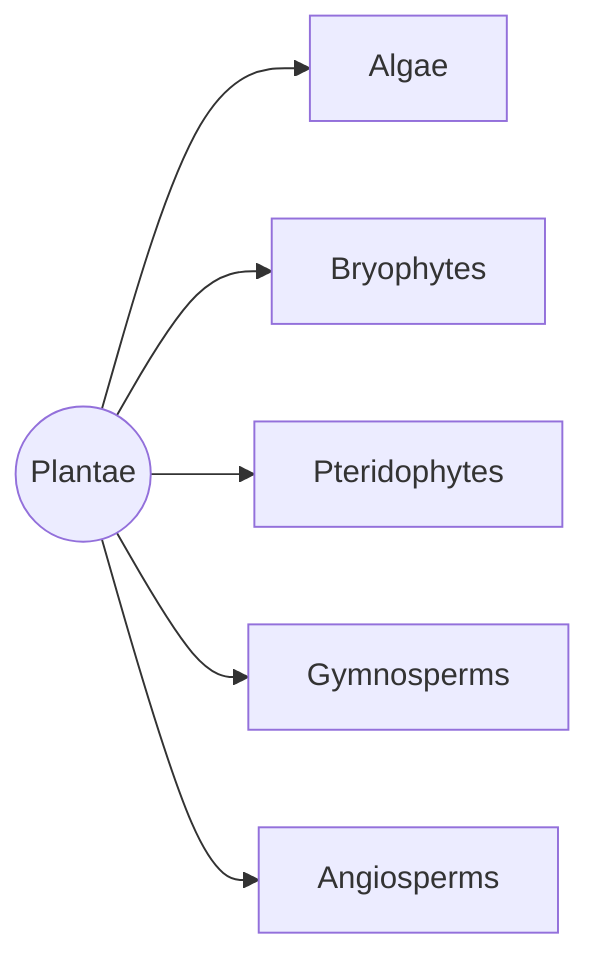
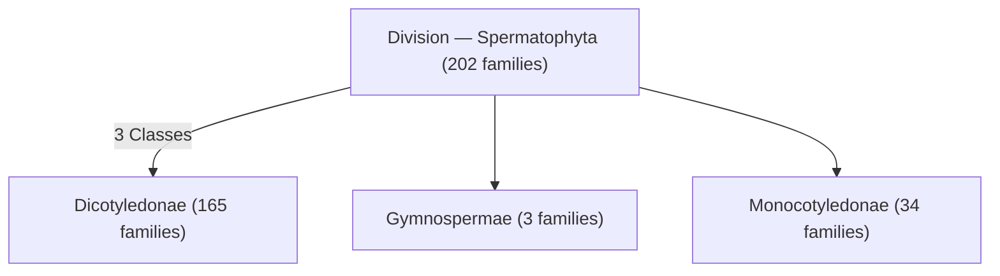
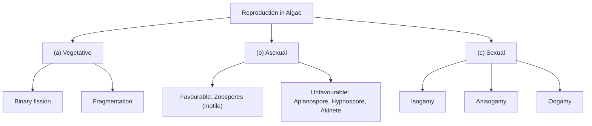
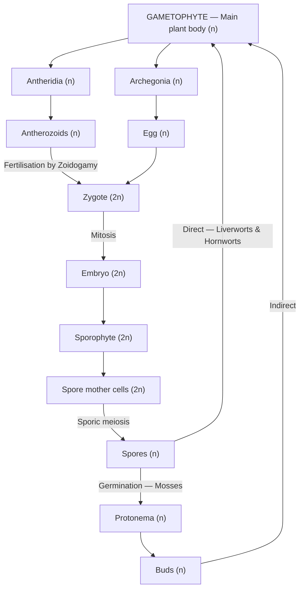
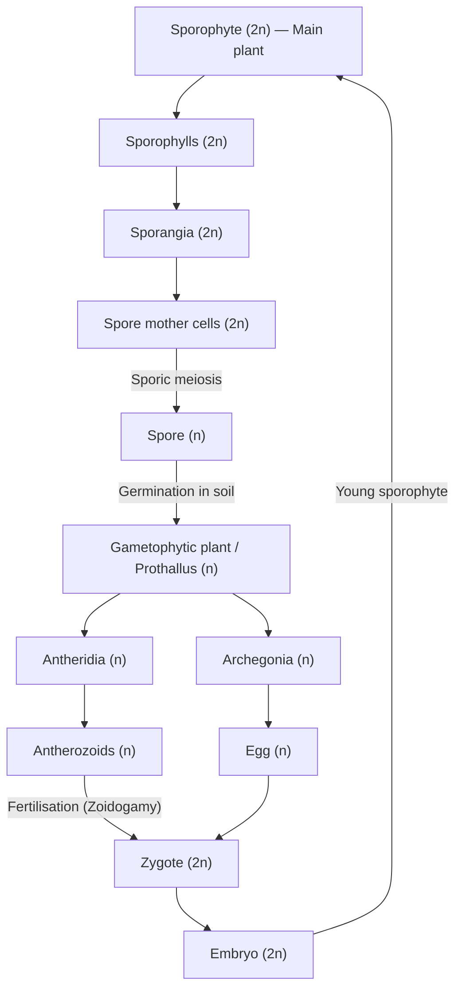
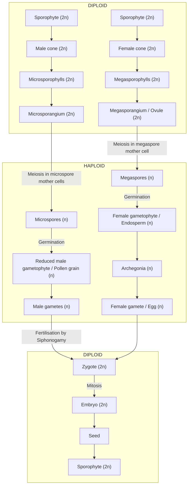

# 🌿 Chapter 03 — Plant Kingdom (NEET Biology)

> Complete notes from the ALLEN module (pages 137–174 as uploaded). Every point kept, only re-arranged into a structure that's easy to revise.

---

## 📑 Table of Contents

1. [Introduction](#1-introduction)
2. [Need of Classification](#2-need-of-classification)
3. [Types of Classification](#3-types-of-classification)
4. [Bentham & Hooker](#4-george-bentham--joseph-dalton-hooker)
5. [Natural Classification — Two Types](#5-natural-classification-is-of-two-types)
6. [Phenetic / Numerical Classification](#6-phenetic-or-numerical-classification)
7. [Taxonomy & Its Types](#7-taxonomy-and-its-types)
8. [Alternation of Generation](#8-alternation-of-generation)
9. [Algae](#9-algae)
10. [Classes of Algae](#10-classes-of-algae)
11. [Bryophytes](#11-bryophytes)
12. [Pteridophytes](#12-pteridophytes)
13. [Gymnosperms](#13-gymnosperms)
14. [Angiosperms](#14-angiosperms)
15. [Golden Key Points](#15-golden-key-points-bryophytes--gymnosperms)
16. [Essence](#16-essence)
17. [Master Comparison Table](#17-master-comparison-table)
18. [NCERT Summary](#18-ncert-summary)
19. [All NCERT Questions](#19-all-ncert-questions-in-this-chapter)

---

## 1. Introduction

- Kingdom Plantae includes all **eukaryotic** (cell wall mainly made of **cellulose**), **chlorophyll-containing** organisms.
- Most are **autotrophs**, with a few exceptions that are **partially heterotrophs**, such as **insectivorous plants**:
  - Bladderwort — *Utricularia*
  - Venus fly trap — *Dionaea*
- ***Cuscuta*** (Amarbel / dodder plant) is an example of a **parasitic angiosperm**.



---

## 2. Need of Classification

**(a)** Enormous biodiversity.

**(b)** It is nearly impossible to study all living organisms, so it is necessary to devise some means to make this possible.

- **Biological classification** = the art of **identifying** distinctions among organisms and placing them into **groups** that reflect their most significant **features and relationship**.
- **Purpose of biological classification** = to organise the vast number of known organisms into categories that can be remembered and studied easily.

| Previous / Old classification | Modern classification |
|---|---|
| Fungi, members of Monera and Protista placed in the **same** kingdom (Plantae), based on cell wall. | Fungi, members of Monera and Protista placed in **different** kingdoms (excluded from Plantae). |

---

## 3. Types of Classification

> [!TIP]
> **Order to remember:** **P**ractical → **A**rtificial → **N**atural → **P**henetic  ("**PAN-P**")

### (i) Practical Classification

- Plants classified on the basis of **economic importance** or **human use (food, shelter, clothing)**.
- This is the **earliest system**.
- Examples:
  - Oil-yielding plants: Coconut, Walnut
  - Spice-yielding plants: Turmeric, Ginger, Clove
- **Limitation:** One plant can be a member of **more than one group**.
  - e.g. **Turmeric** — multi-use plant, gives both medicines and spices.

### (ii) Artificial Classification

- Plants classified on the basis of **one or few superficial morphological characters** like **habit, colour, number and shape of leaves**, i.e. overall morphology is **not** considered.
- Classification proposed by **Linnaeus** is artificial — based on **androecium structure and numbers**.
- **Equal weightage** given to both **vegetative and reproductive** characters.
- **Not acceptable** because vegetative characters are more easily affected by **environment**.

### (iii) Natural Classification

- Plants classified on the basis of their **complete (gross) morphological** characters (stem, root, leaves, flowers etc.).
- Based on **natural affinities** among organisms.
- Considers not only **external characters** but also **internal features**, like:
  - ultra-structure
  - anatomy
  - embryology
  - phytochemistry
- **Natural classification of flowering plants was given by George Bentham and Joseph Dalton Hooker.**

**Importance:**
- Believed to be the **best classification**, because it represents the natural (affinities) **similarities and dissimilarities** of plants, i.e. the **inter-relationship** among plants.
- More weightage is given to **floral or sexual characters** because they are **more conservative** than vegetative characters.

*(Figure: Flower, Androecium, Gynoecium)*

---

## 4. George Bentham & Joseph Dalton Hooker

1. Both were related to the **Royal Botanical Garden**.
2. They gave the **biggest** and **natural** classification of **Spermatophyta** (seeded plants):



> [!TIP]
> **165 + 3 + 34 = 202** families.

**Merits:**
- The classification is natural, mainly based on **floral characters** and **actual observations**.

**Demerits:**
- **Phylogeny** of plants is **not considered**. The correct sequence of evolution is:

> **Phylogeny = Gymnosperm → Dicots → Monocots**
> (Bentham & Hooker placed Gymnospermae *between* Dicots and Monocots.)

---

## 5. Natural Classification is of Two Types

| Type | What is considered |
|---|---|
| **(a) Natural non-phylogenetic** | Phylogeny **not** considered — only **gross morphology**. |
| **(b) Natural phylogenetic** | Both **gross morphology** and **phylogeny** considered. Plants arranged on the basis of **evolution** (organisms of the same taxa have a **common ancestor**). |

- **Phylogenetic classifications are also known as cladistic classifications**, because when demonstrated in outline form they look **tree-like**, since taxa are arranged according to their evolutionary sequence.

**Note:** Plants arranged on the basis of evolution:

```
Algae → Bryophytes → Pteridophytes → Gymnosperms → Angiosperms
Primitive ─────────────────────────────────────────→ Advanced
```

- At present, **phylogenetic classification systems** based on evolutionary relationships are acceptable. They assume organisms of the same taxa have a **common ancestor**.
- Information from many other sources is now used to help resolve difficulties in classification. These become **more important when there is no supporting fossil evidence**.

---

## 6. Phenetic or Numerical Classification

- Plants classified on the basis of the **number of similarities and dissimilarities**.
- Easily carried out using **computers**, based on **all observable characteristics**.
- **Numbers and codes** are assigned to all characters → data prepared → processed.
- Organisms with **maximum similarities** are placed in the same group.
- Each character gets **equal importance**, and **hundreds of characters** can be considered at the same time.

---

## 7. Taxonomy and Its Types

> **Taxonomy → Taxis = Arrangement, Nomos = Law**

- Branch of biology dealing with **identification, nomenclature and classification** of organisms.
- Word proposed by **A.P. de Candolle**.

| Type | Based on | Key points |
|---|---|---|
| **(i) Cytotaxonomy** | **Cytological characters** | Chromosome number, structure, behaviour etc. used in classification / solving taxonomic problems |
| **(ii) Chemotaxonomy** | **Chemical constituents** | Alkaloids, carotenoids, tannins, polysaccharides, nucleic acids, fatty acids, amino acids, aromatic compounds etc. |
| **(iii) Numerical / Phenetic taxonomy** | **All observable characteristics** | Done using computers; numbers & codes assigned; each character equal importance; hundreds of characters; **saves time and hard work** |

> [!TIP]
> **C**yto = **C**hromosomes · **C**hemo = **C**hemicals · **N**umerical = **N**umbers/computers

- Plant cells have a **eukaryotic** structure with **prominent chloroplasts** and a cell wall mainly made of **cellulose**.

---

## 8. Alternation of Generation

- Plant life cycle has two distinct phases:
  - **Diploid sporophytic** phase
  - **Haploid gametophytic** phase
- These **sporophyte** and **gametophyte** **alternate** with each other.
- Their **length** and **nature** (free-living or dependent) **vary** among different groups of plants.


---

## 9. Algae

### 9.1 General Characters

- Algae are **chlorophyll-bearing, simple, thalloid, autotrophic** and **largely aquatic** (both fresh water and marine) organisms.
- Also found in other habitats: **moist stones, soils and wood**.
- Some occur in association with:
  - **Fungi** → **lichen**
  - **Animals** → e.g. on the **sloth bear**, *Cyanoderma* and *Trichophilus* are present.

### 9.2 Nature

- Found in **both fresh** and **marine water**.
- Forms:
  - **Filamentous** — *Ulothrix*, *Spirogyra*
  - **Colonial** — *Volvox*
  - **Microscopic unicellular** — *Chlamydomonas*
- (Module line: "A few of the marine forms like *Ulothrix* and *Spirogyra*.")
- A few marine forms such as **kelps** form **massive plant bodies**.
- Surrounded by a **mucilaginous sheath**; below the sheath is the **cell wall** made of **cellulose, galactans, mannans and minerals**.
- Body = **thallus / thalloid**, i.e. **not differentiated** into leaves, stem and roots.
- Nutrition: **photoautotrophic (oxygenic phototrophs)**; have **plastids** with photosynthetic pigments.
- Plant body of most algae is made of **haploid cells**.
- **Non-vascular** — no vascular tissues.

### 9.3 Reproduction



#### (a) Vegetative Reproduction

| Type | Description | Example |
|---|---|---|
| **(i) Binary fission** | Cell divides into **two parts** | Found **only in unicellular** algae |
| **(ii) Fragmentation** | Filaments break into **small pieces** & form new filaments | **All filamentous algae** (e.g. *Spirogyra*) |

#### (b) Asexual Reproduction

- **Zoospores (motile)** — formed in **favourable** conditions; **flagellated**; germinate to give new plants (e.g. new young *Chlamydomonas*).
- **Hypnospore, aplanospore and akinete** — formed in **unfavourable** conditions.

| Spore | Wall |
|---|---|
| **Aplanospore** | **Thin-walled** spores |
| **Hypnospore** | **Thick-walled** spores |
| **Akinetes** | **Mother cell itself converts** into thick-walled spore |

> [!TIP]
> **Z**oospore = **Z**ippy (motile) & happy (favourable). **A-H-A** (Aplano, Hypno, Akinete) = bad times.

#### (c) Sexual Reproduction

- **Gametic fusion** occurs.
- Male sex organ = **antheridium**; female = **oogonium**.
- In algae sex organs are **unicellular & jacketless**, so more correctly called **male sex cells** and **female sex cells**.
- ***Chara*** — sex organs are **multicellular** and **jacketed**.
  - **Nucule ♀** = Oogonium
  - **Globule ♂** = Antheridium

**Three types of sexual reproduction:**

| Type | Gametes | Example |
|---|---|---|
| **Isogamy** | Simplest. Fusing gametes **morphologically similar** (shape, size, structure) | Flagellated isogamy in ***Ulothrix*** |
| **Anisogamy** | Fusing gametes **morphologically dissimilar** (smaller – larger) | ***Eudorina*** |
| **Oogamy** | Developed form of anisogamy. **Male gamete small, motile or immotile; female gamete large, immotile** | ***Volvox, Fucus, Sargassum, Chara*, Red algae** |

- **Note:** In ***Spirogyra*** gametes are **identical (isogamy)** and **non-motile (non-flagellated)**.
- In oogamy, the female gamete does **not** come outside the female reproductive cell; fertilisation takes place in the sex organ / female reproductive cell only.
- Different species of ***Chlamydomonas*** show isogamy, anisogamy **and** oogamy → **complete evolution of sexual reproduction** can be seen in the single genus *Chlamydomonas*.

### 9.4 Economic Importance of Algae

| Algae / Product | Use |
|---|---|
| ***Chlorella*** | Unicellular, **rich in protein**; food supplement even for **space travellers** |
| ***Porphyra, Laminaria, Sargassum*** | Among the **70 species** of marine algae used as **food** |
| **Hydrocolloids** (water-holding substances) | Produced in large amounts by marine brown & red algae — **Algin (brown algae)**, **Carrageen (red algae, *Chondrus crispus*)** used commercially |
| ***Gelidium* & *Gracilaria*** (red algae) → **Agar** | Hydrocolloid; used to prepare **culture medium** for microbes, and in **ice-creams and jellies** |
| **Alginates / Alginic acid** — from ***Laminaria, Fucus, Macrocystis*** | **Denture measurement**, polish, manufacturing of **soap, ice-creams** |
| ***Laminaria*** | Source of **Iodine** and **Bromine** |

- At least **half of the total CO₂ fixation** on earth is by algae through photosynthesis.
- Being photosynthetic, they **increase dissolved oxygen** in their immediate environment.
- **Primary producers** of energy-rich compounds — basis of food cycles of all aquatic animals.

> [!TIP]
> **Agar → G-G** (*Gelidium*, *Gracilaria*) · **Algin → Brown** · **Carrageen → Red** · **Iodine → *Laminaria***

---

## 10. Classes of Algae

> **NCERT Q:** What is the basis of classification of algae?
> → Mainly the **photosynthetic pigments** (also type of stored food).

| Class | Common name |
|---|---|
| (A) **Chlorophyceae** | Green algae |
| (B) **Phaeophyceae** | Brown algae |
| (C) **Rhodophyceae** | Red algae |

### (A) Chlorophyceae — Green Algae 🟢

- Usually **grass green** due to dominance of **chlorophyll a and b**.
- **Most advanced algae**; believed to be **ancestors of higher plants**.
- **Habitat:** Cosmopolitan — fresh, brackish and salty water.
- **Structure:** Rigid cell wall — **inner layer cellulose**, **outer layer pectose**.

**Forms:**
1. **Unicellular**
   - *Chlamydomonas* — **motile**, moves by flagella
   - *Chlorella* — **non-motile**
2. **Colonial** — *Volvox* — **motile colony** (parent colony with daughter colonies)
3. **Multicellular filamentous** (most green algae)
   - *Ulothrix, Spirogyra* — **unbranched** filamentous
   - *Chara* — **branched** filamentous

*(Figure: Chlamydomonas — flagellum, vacuole, nucleus, chloroplast, pyrenoid)*

**Photosynthetic pigments:** localised in definite **chloroplasts**. Chloroplast may be **discoid, reticulate, cup-shaped, spiral or ribbon-shaped** in different species.

| Pigment | Type |
|---|---|
| Chlorophyll | Chl **a** and Chl **b** |
| Carotene | **β-carotene** |
| Xanthophyll | Yellow coloured (**Luteoxanthin, Violaxanthin**) |

- **Stored food:** **Starch**; some have **oil droplets** too.
- **Vegetative reproduction:** Fragmentation.
- **Asexual reproduction:** **Zoospores** in favourable conditions (in **zoosporangia**); aplanospore, hypnospore, akinete in unfavourable conditions.
- **Sexual reproduction:** Considerable variation; may be **isogamous, anisogamous or oogamous**.
- On basis of pigments (Chl a, Chl b, carotenoids), stored food (**starch**) & cell wall (**cellulose and pectose**), green algae are considered **similar to higher plants**.
- Most members have one or more storage bodies called **pyrenoids** in chloroplasts. Pyrenoids contain **protein besides starch**.
- **Common examples:** *Chlamydomonas, Volvox, Ulothrix, Spirogyra, Chara*.

### (B) Phaeophyceae — Brown Algae 🟤 (Sea weeds)

- **Habitat:** Primarily **marine**.
- **Structure:** Great variation in size and form — from **simple branched filamentous** (*Ectocarpus*) to **profusely branched kelps**.
- **Largest algae** — up to **100 m** in length (**kelp**).
- Body attached to substratum by a **holdfast**, has a **stalk (stipe)** and leaf-like photosynthetic part, **frond / lamina** → also called **leafy algae** (e.g. *Laminaria*).
- Vegetative cells have a **cellulosic wall** usually covered outside by a **gelatinous coating of algin**.
- Protoplast contains **plastid, centrally located vacuole and nucleus**. e.g. *Fucus, Dictyota, Ectocarpus*.

*(Figure: Laminaria — frond, stipe, holdfast · Fucus — air bladder, frond, midrib, holdfast · Dictyota — frond, stipe)*

**Gelatinous coating / Phycocolloids / Hydrocolloids:**
- Algin has **very high water-holding capacity**.
- **Phycocolloids (algin)** protect brown algae against **desiccation and shocks**.
- Used in ice-cream as **thickening agent**.
- **Algin / alginate salt** used for **denture measurement**.
- Algin used in manufacturing **soap, ice-cream, polish, cream and plastic**.

| Pigment | Type |
|---|---|
| Chlorophyll | Chl **a**, Chl **c** |
| Carotene | **Only β-carotene** |
| Xanthophylls | Mainly **Fucoxanthin** (brown colour) |

- **Stored food:** Complex carbohydrates — **laminarin and mannitol**.
- **Vegetative reproduction:** Fragmentation.
- **Asexual reproduction:** Mostly by **biflagellate zoospores** — **pear-shaped**, two **unequal, laterally** attached flagella.
- **Sexual reproduction:** Isogamous, anisogamous or oogamous. Union of gametes in **water** or **within the oogonium** (oogamous species).
- Gametes are **pear-shaped (pyriform)** with two unequal laterally attached flagella.
- **Kelps:** profusely branched, giant algae.
- **Common forms:** *Ectocarpus, Dictyota, Laminaria, Sargassum, Fucus*.

### (C) Rhodophyceae — Red Algae 🔴

- Called red algae due to **predominance of red pigment r-phycoerythrin**.
- **Ancient (primitive)** algae. e.g. *Polysiphonia*.
- **No motile stage** in life cycle — cilia & flagella **absent**.
- Some have **complex body organisation**.
- **Habitat:** Mostly **marine**, greater concentration in **warmer areas**.
- **Structure:**
  - Red thalli are **multicellular**.
  - Cell wall: **cellulose, pectin and polysulphate esters**.

| Pigment | Type |
|---|---|
| Chlorophyll | Chl **a** and Chl **d** |
| Carotenes | **β-carotene** |
| Phycobilins | **r-phycoerythrin (red)** and **r-phycocyanin (blue)** |

- Occur in both **well-lighted regions near the surface** and at **great depths** where little light penetrates.
- **r-phycoerythrin** gives them the ability to photosynthesise even in **deep areas**.
- **Stored food:** **Floridean starch** — structurally similar to **glycogen and amylopectin**.
- **Vegetative reproduction:** Fragmentation.
- **Asexual reproduction:** **Non-motile spores**.
- **Sexual reproduction:** **Oogamous**, with **complex post-fertilisation developments**; gametes **non-motile** (no cilia/flagella).
- **Common members:** *Polysiphonia, Porphyra, Gracilaria, Gelidium*.

*(Figure: Porphyra — frond · Polysiphonia — main axis, branches)*

> **NCERT Q:** Differentiate between red algae and brown algae. → See table below.

### 📊 Classes of Algae & Main Characteristics

| Class | Common name | Major pigments | Stored food | Cell wall | Flagella (number & insertion) | Habitat |
|---|---|---|---|---|---|---|
| **Chlorophyceae** | Green algae | Chl a, b | Starch | Cellulose & pectose | 2–8, equal, apical | Fresh, brackish, salt water |
| **Phaeophyceae** | Brown algae | Chl a, c, fucoxanthin | Mannitol, laminarin | Cellulose & algin | 2, unequal, lateral | Fresh (rare), brackish, salt water |
| **Rhodophyceae** | Red algae | Chl a, d, phycoerythrin | Floridean starch | Cellulose & pectin with polysulphate ester | Absent | Fresh (some), brackish, salt water (most) |

> [!TIP]
> **Chlorophyll partner letter:** Green = **b** · Brown = **c** · Red = **d** → just go **b → c → d** in the order **G → B → R**.

### ⭐ Golden Key Points (Algae)

- Algae are chlorophyll-bearing, simple, thalloid, autotrophic and largely aquatic (fresh water and marine).
- *Chlorella*, a unicellular alga rich in proteins, is used as food supplement even by space travellers.
- Plant body usually attached to substratum by a **holdfast**, has a stalk — the **stipe**, and leaf-like photosynthetic organ — the **frond**.
- Gametes or zoospores are **pyriform (pear-shaped)** and bear **two laterally attached flagella**.
- Rhodophyceae are called red algae due to predominance of **r-phycoerythrin**.
- Sexual reproduction is **oogamous** and accompanied by **complex post-fertilisation developments**.
- **Agar**, from *Gelidium* and *Gracilaria*, is used to grow microbes and in ice-creams and jellies.

### 📝 Beginner's Box-1 (Systems of Classification, Taxonomy, Algae)

1. According to Whittaker, kingdom Plantae includes all :-
   (1) Unicellular, eukaryotic autotrophic plants
   (2) Multicellular, eukaryotic, autotrophic plants
   (3) Multicellular, eukaryotic organisms
   (4) Unicellular/multicellular eukaryotic autotrophic plants — *BC02-0020*
2. Which of the following thick-walled spores protect algae from unfavourable condition?
   (1) Pyrenoids (2) Zoospore (3) Hypnospores and Akinetes (4) Zoospores and Aplanospores — *PK01-0004*
3. Which of the following is not found in algae?
   (1) Meiosis (2) Embryo (3) Zygote (4) Fertilization — *PK01-0006*
4. In *Spirogyra* isogametes are :-
   (1) Non-flagellated (2) Single flagellated (3) Biflagellated (4) Multiflagellated — *PK02-0011*

<details>
<summary>Show answers (based on the notes above)</summary>

1. (2) Multicellular, eukaryotic, autotrophic plants
2. (3) Hypnospores and Akinetes
3. (2) Embryo (embryo is absent in algae)
4. (1) Non-flagellated

</details>

---

## 11. Bryophytes

### 11.1 General Characters

- **First land plants**; believed to have originated from **aquatic plants**.
- **Not successful land plants** — vascular tissue absent & they need water for fertilisation.
- Called **amphibians of the plant kingdom** — can live in soil but depend on water for fertilisation.
- **Lack true roots, stem or leaves**; may have **root-like, leaf-like or stem-like** structures.
- **Sciophytes** — prefer **cool, moist (wet) and shady** places.
- Little economic importance, but some mosses provide food for **herbaceous mammals, birds** and other animals.
- Water-conducting tissue = **parenchyma**.
- Include **mosses and liverworts**, commonly found in moist, shaded areas in the hills.

### 11.2 Life Cycle of Bryophytes



**Key points of the life cycle:**
- Main plant body is **haploid**; produces gametes → called **gametophyte**.
- Sex organs formed on gametophyte; **multicellular and jacketed**.
  - Male = **antheridium**
  - Female = **archegonium** — **flask-shaped**, produces a **single egg**.
- Male gametes are **motile** = **antherozoids** — usually **comma-shaped and biflagellate**.
- Female gamete = **egg / ovum**.
- Fertilisation by **zoidogamy** — male gamete **swims through water** to reach the female gamete.
- Fertilisation → diploid **zygote**. Zygote does **not undergo meiosis immediately**.
- Zygote → embryo → **sporophyte** by **mitosis**. Sporophyte generation = **diploid**.
- Sporophyte is **not free-living**; attached to the photosynthetic gametophyte and **derives nourishment** from it.
- Sporophyte is made of **foot, seta and capsule** (not root, stem, leaves) → called **sporogonium**.
- Some cells in the capsule act as **spore mother cells** → **meiosis** → haploid spores.
- **Sporophyte dependent on gametophyte = unique character of Bryophyta.**

**Spore germination:**

| Type | Group | What happens |
|---|---|---|
| **Direct** | **Liverworts** | Each spore forms a **gametophyte / thallus** |
| **Indirect** | **Mosses** | Spore forms a multicellular filament = **protonema** |

- **Primary protonema** — developed from **spores**.
- **Secondary protonema** — developed from **parts other than spores**.
- Protonema is **creeping, green, branched and filamentous**.
- **Lateral buds** form on protonema; each bud develops into a **gametophore**. Indirect germination is best for survival. Mosses are **gregarious** (appear in groups).

### 11.3 Liverworts (Hepaticopsida)

- Shape like **liver** (e.g. *Marchantia*) or **flat** (e.g. *Riccia*) → called liverworts.
- Plant body is **thallus-like**; thallus is **dorsiventral** and **closely appressed** to the substrate.
- **Rhizoids** and **scales** present on thallus:
  - Rhizoids — **unicellular and unbranched**
  - Scales — **multicellular**, **protective** function
- **Leafy members** (e.g. *Porella*) have tiny leaf-like appendages in **two rows** on stem-like structures.
- Sporophyte is **completely dependent** on gametophyte (for **food, water and habitat**).
- Sporophyte = **foot, seta, capsule**; spores formed in capsule after meiosis; spores germinate into **free-living gametophytes**.
- **True elaters** present in sporophyte of some liverworts — **hygroscopic**, help in **spore dispersal**.
- **Asexual (vegetative) reproduction:**
  - **Fragmentation** of thalli, or
  - **Gemmae** (sing. gemma) — **green, multicellular, asexual buds**, develop in small receptacles called **gemma cups** on thalli; detach and germinate into new individuals. e.g. *Marchantia*.
- **Sexual reproduction:** male and female sex organs on:
  - **Same thallus** — e.g. *Riccia*
  - **Different thalli** — e.g. *Marchantia*

*(NCERT Fig. 3.2 — Marchantia: (a) Female thallus — archegoniophore, gemma cup, rhizoids; (b) Male thallus — antheridiophore, gemma cup, rhizoids)*

> [!TIP]
> ***R**iccia* = **R**oommates (same thallus) · ***M**archantia* = **M**ale and female separate.

### 11.4 Mosses (Bryopsida)

- Predominant stage = **gametophyte**, with **two stages**:
  1. **Protonema stage** — develops directly from a spore; **creeping, green, branched, frequently filamentous**.
  2. **Leafy stage** — develops from **secondary protonema** as a **lateral bud**; **upright, slender axes** bearing **spirally arranged leaves**.
- Main plant body = stem-like, leaf-like and **rhizoids** (root-like); attached to soil by rhizoids.
- Rhizoids are **multicellular, branched and obliquely septate**.
- **Vegetative reproduction:** **Fragmentation** and **budding** in secondary protonema.
- **Sexual reproduction:** antheridia and archegonia produced at the **apex of leafy shoots**.
- After fertilisation, zygote → sporophyte (**foot, seta, capsule**). Capsule contains spores formed after **meiosis**.
- Sporophyte in mosses is **more elaborate** than in liverworts.
- Sporophyte of mosses is **partially dependent (semi-parasite)** like hornworts, i.e. it is **photosynthetic**.
- Mosses have an **elaborate mechanism of spore dispersal**.
- **Peristomial teeth** present in moss sporophyte — help in **spore dispersal**.
- **Common examples:** *Funaria, Polytrichum, Sphagnum*.

*(NCERT Fig. 3.2 (c) — Funaria: Sporophyte = capsule + seta; Gametophyte = leaves, main axis, rhizoids)*

#### *Sphagnum*

- **Peat moss** — fossil fuel obtained from **bog**. Peat forms by fossilisation of *Sphagnum*.
- *Sphagnum* grows in **acidic bogs**; few bacteria there → dead cells don't degrade → stays as fossil.
- **Absorbent cotton:** absorbs **very high amounts of water** → used as absorbent cotton in **Europe**.

*(NCERT Fig. 3.2 (d) — Sphagnum gametophyte: antheridial branch, archegonial branch, branches)*

### 11.5 Economic & Ecological Importance of Bryophytes

- Little economic importance in general.
- Some mosses → food for **herbaceous mammals, birds** and other **animals**.
- *Sphagnum* → **peat**, used as **fuel**; and due to water-holding capacity, as **packing material for trans-shipment** of living material.
- Mosses + **lichens** = **first organisms to colonise rocks** → great ecological importance. They **decompose rocks**, making substrate suitable for higher plants.
- Mosses form **dense mats** on soil → reduce impact of falling rain → prevent **soil erosion**.

> **NCERT Q:** Differentiate between liverworts and moss. → See [Essence table](#16-essence).

---

## 12. Pteridophytes

### 12.1 General Characters

- **Pteridophyte:** *Ptero* = wings (feathers), *phyta* = plants.
- Beautiful **non-seeded first vascular plants** on earth.
- Include **whisk ferns, club mosses, horsetails and ferns**.
- Uses: **medicinal**, **soil binders**, frequently grown as **ornamentals**.
- Evolutionarily the **first terrestrial plants with vascular tissues — xylem and phloem**.
- Found in **cool, damp, shady** places; some grow well in **sandy soil** too.
- Bryophytes: dominant phase = **gametophyte**. Pteridophytes: main body = **sporophyte**, differentiated into **true root, stem and leaves**.
- Organs have well-differentiated **vascular tissues**.
- In both pteridophytes **and** gymnosperms: **xylem lacks vessels**, **phloem lacks sieve tubes and companion cells**.
- **Cambium absent** → no **secondary growth** → they are **herbs or shrub-like** plants.
- **Not completely successful land plants** — need **water for fertilisation**.

**On the basis of leaves:**

| Type | Stem vs leaves | Example |
|---|---|---|
| **Megaphyllous** | Stem **smaller**, leaves **larger** | **Ferns** |
| **Microphyllous** | Stem **larger**, leaves **smaller** | ***Selaginella*** |

- Stem is **erect or prostrate**; underground stem = **rhizome**.

*(Figure: Fern — fronds, leaflet, ramenta, rhizome, circinate vernation, adventitious root)*

### 12.2 Life Cycle of Pteridophytes



- Sporophyte bears **sporangia** subtended by leaf-like appendages = **sporophylls**.
- Plant = **sporophyte** (diploid); reproduces by **spore formation** in **sporangia**, mostly on **leaves**.
- Most are **homosporous** — only **one type** of spore.
- **Exception:** some are **heterosporous** — two types: **microspores** and **megaspores**.
- **Trophophylls** (foliage / vegetative leaves) = green, normal photosynthetic leaves.
- **Sporophylls** (reproductive leaves) = leaves bearing sporangia.
- Sporangia in groups = **sorus** (pl. **sori**), found on sporophylls.
- **In ferns, sporophylls are also photosynthetic — a unique character**; otherwise sporophylls are generally **non-green**.
- Spore mother cells in sporangia → **meiosis** → spores → start **gametophytic generation**.
- Each spore germinates in soil into a **small, multicellular, inconspicuous, non-vascular, thalloid gametophyte** = **prothallus**.
- Prothallus is **free (independent)** and mostly **photosynthetic**.
- Gametophytes need **cool, damp, shady** places. Due to this restricted requirement + need of water for fertilisation, spread of living pteridophytes is **limited to narrow geographical regions**.
- **No attachment** between sporophyte and gametophyte → both are **free-living / independent** generations.
- On **ventral side** of prothallus: rhizoids and sex organs.
  - Male = **antheridium** → **antherozoids** — **spiral, multiflagellate**
    - **Exception:** *Selaginella* antherozoids are **spindle-shaped and biflagellate**.
  - Female = **archegonium** → **egg / ovum**.
- Fertilisation by **zoidogamy** → zygote → **embryo** → young **sporophytic plant** with root, stem, leaves.
- **In the plant kingdom, the gametophyte is always non-vascular.**

*(Figure: Gametophyte or Prothallus — archegonia, antheridia, rhizoids)*

### 12.3 Heterospory

> **NCERT Q:** What is heterospory? Briefly comment on its significance. Give two examples.
> **NCERT Q:** Differentiate between homosporous and heterosporous pteridophytes.

- In a few pteridophytes, **two types of spores** — **microspores** and **megaspores** — formed in **microsporangium** and **megasporangium** respectively = **heterospory**.
- **Heterosporous pteridophytes:** ***Selaginella, Salvinia, Marsilea***.
- Microspore → **male gametophyte**; megaspore → **female gametophyte**.
- Development of zygote into young embryo takes place **within the female gametophyte**.
- This is a **precursor of seed habit** — an important step in evolution.
- Female gametophytes are **retained on the parent sporophyte** for variable periods, inside the **megasporangium**.

**Why no seed even with heterospory?**
- Seed formation needs an **integumented megasporangium (ovule)**, through which the developing embryo cannot come out, so the whole structure converts into a seed.
- In heterosporous pteridophytes the megasporangium is **not covered by integuments** → **no seed**.

### 12.4 Classification of Pteridophyta

| Class | Common name | Body | Example |
|---|---|---|---|
| **(i) Psilopsida** | — | **Most primitive vascular plants**; stem (rhizome), scaly leaves, rhizoids | ***Psilotum*** — a **living fossil** |
| **(ii) Lycopsida** | **Club moss** | Root, stem, leaves (**microphylls**); produce **cones/strobili** at top of stem/branches (cones = aggregation of sporophylls) | ***Lycopodium*, *Selaginella*** (*Selaginella* = **pioneer of heterospory**) |
| **(iii) Sphenopsida** | **Horsetails** | Root, stem, rhizome, scaly leaves; stem clearly differentiated into **nodes and internodes**; cone/strobilus at top of aerial stem | ***Equisetum*** |
| **(iv) Pteropsida** | **Ferns** | Root, stem, rhizome, **large leaves (macrophylls / megaphylls)** | *Azolla* (**smallest fern**), *Salvinia, Marsilea, Dryopteris, Pteris, Pteridium, Adiantum* |

*(Fig 3.3 — (a) Selaginella: stem, leaves, roots · (b) Equisetum: strobilus, node, internode, branch, stem, soil, rhizome, adventitious roots · (c) Ferns · (d) Salvinia: floating leaves, submerged leaves)*

**Pteropsida extra points:**
- Very good **ornamental plants**.
- Leaves **pinnately compound** and **circinately coiled** when young → called **frond**.
- Most **fossil fuel (coal)** today is from fossilisation of **giant ferns** (pteridophytes).

> [!TIP]
> **P-L-S-P** → **P**silotum, **L**ycopodium, **S**(Ph)enopsida-*Equisetum*, **P**teropsida-ferns → "**P**lease **L**eave **S**ome **P**lants"

> **NCERT Q:** Both gymnosperms and angiosperms bear seeds, then why are they classified separately?

---

## 13. Gymnosperms

### 13.1 General Characters

- *Gymnos* = naked, *sperma* = seed → **ovules not enclosed** by any ovary wall; remain **exposed before and after fertilisation**.
- **First completely successful terrestrial plants**.
- **Hard, woody, tree habit — arborescent**. Gymnosperms are **only perennials**.
- Main body divided into **root, stem and leaves**.
- Roots generally **tap roots**.
- Some roots have fungal association = **mycorrhiza** (***Pinus***).
- In ***Cycas***, small specialised roots called **coralloid roots** are associated with **N₂-fixing cyanobacteria**.
- In *Cycas*, roots are of **two types** — **tap root** and **coralloid roots**.
- Stems: **unbranched** (*Cycas*) or **branched** (*Pinus, Cedrus*).
- Leaves may be **simple or compound**.
- In *Cycas*, **pinnate leaves persist for a few years**.
- Leaves **well-adapted to extreme conditions** — temperature, humidity, wind.
- In **conifers**, **needle-like leaves** reduce surface area; **thick cuticle** and **sunken stomata** reduce water loss.
- **Naked-seeded** — **no fruit** formation; embryo & seed form but no fruit.
- Include **medium-sized / tall trees and shrubs**. Giant redwood ***Sequoia*** is one of the **tallest** tree species.
- All are **vascular**: **xylem lacks vessels**, **phloem lacks sieve tubes and companion cells**.
  - **Exception:** **Gnetales** order — **vessels present**.
- ***Cycas* is a living fossil.**

*(NCERT Fig. 3.4 — (a) Cycas: megasporophylls, foliage leaves, male cone, stem, old leaf bases · (b) Pinus — monoecious plant · (c) Ginkgo biloba: dwarf shoot, long shoot, seeds)*

### 13.2 Life Cycle of Gymnosperms

1. Main body = **sporophyte**, diploid (2n). **Most gymnosperms are dioecious** (male & female plants separate).
2. **All gymnosperms are heterosporous**:
   - **Microspores (male)**
   - **Megaspores (female)**
   *(Cycas: female plant — megasporophyll; male plant — male cone)*
3. Formed in two different sporangia:
   - Microspores → **microsporangia**
   - Megaspores → **megasporangia**. Megasporangia are **integumented → called ovules**.
4. Sporangia formed on different sporophylls:
   - Microsporangia on **microsporophylls**
   - Megasporangia on **megasporophylls**
5. These sporophylls form **male cone** and **female cone** respectively. Cones / strobili may be **loose or compact**.
6. **Microspores** formed by **meiosis** in microsporangium cells; **megaspores** by meiosis in **megasporangium (ovule)**.
7. Microspores germinate → **male gametophyte** = **pollen grain** → forms male gametes.
   - **Antheridia are absent in gymnosperms. Pteridophyta is the last group with antheridia.**
8. Male gametes are **motile and multiciliate** in very few gymnosperms like ***Cycas, Ginkgo***; **non-motile** in most higher gymnosperms (no cilia/flagella).
9. Main body of ovule = diploid tissue = **nucellus / megasporangium**.
   - One nucellus cell acts as **megaspore mother cell** → **meiosis** → **4 haploid megaspores** → **1 functional**, 3 degenerate.
   - Megaspore → **female gametophyte or endosperm**.
   - Cells of female gametophyte/endosperm act like **archegonial initials** → form **two or more archegonia**.
   - Archegonium → forms **egg** (female gamete).
10. Pollen grains reach ovule by pollination — by **wind (anemophily)**.

**Development of zygote:**
- (a) Zygote → **embryo**. After embryo formation, ovule is called **seed** [seed = ovule with embryo].
- (b) Embryo is enclosed in seed; seed absorbs water, ruptures, embryo germinates into diploid **sporophyte**.

> [!IMPORTANT]
> - **Bryophytes & pteridophytes:** male and female gametophytes have an **independent free-living existence**.
> - **Gymnosperms & angiosperms:** male and female gametophytes **do not** have free-living existence — they remain **within the sporangia retained on the sporophyte**.

*(Figures (a)–(f): Megasporophyll with megasporangium → nucellus + integument = ovule → megaspore mother cell → megaspore tetrad → female gametophyte (endosperm) → mature ovule with micropyle, pollen chamber, archegonial chamber, archegonia, endosperm, nucellus tissue, integument)*



### 13.3 Economic Importance

- Economic importance of gymnosperms.
- Economic importance of seeds.
- **Dry fruits, medicinal importance, timber, wood.**

> **NCERT Q:** Write a note on economic importance of algae and gymnosperms.
> **NCERT Q:** Mention the ploidy of: protonemal cell of a moss; primary endosperm nucleus in dicot; leaf cell of a moss; prothallus cell of a fern; gemma cell in *Marchantia*; meristem cell of monocot; ovum of a liverwort; zygote of a fern.
> **NCERT Q:** When and where does reduction division take place in the life cycle of a liverwort, a moss, a fern, a gymnosperm and an angiosperm?
> **NCERT Q:** Name three groups of plants that bear archegonia. Briefly describe the life cycle of any one of them.

---

## 14. Angiosperms

- **Large group** of plants occurring in a **wide range of habitats**.
- In angiosperms (**flowering plants**), **pollen grains and ovules develop in specialised structures called flowers**.
- Typical flower has **four whorls**: **Calyx, Corolla, Androecium, Gynoecium**.
  - Calyx (sepals) + Corolla (petals) = **non-essential / accessory** parts.
  - Androecium + Gynoecium = **essential** parts.
- Seeds are **enclosed in fruits**.
- Size range: smallest ***Wolffia*** to tall trees of ***Eucalyptus*** (**over 100 m**).
- Provide **food, fodder, fuel, fibres, medicines** and many other products.

*(Figure: Flower — stigma, style, ovary, anther, petal, filament, sepal)*

**Two types:**

| Type | Seed | Example |
|---|---|---|
| **(a) Dicotyledons** | Seeds with **two cotyledons** | **Pulses** |
| **(b) Monocotyledons** | **Single** cotyledon | **Cereals & grasses** |

*(Figure: Dicot — cotyledons, plumule, radicle · Monocot — cotyledon, endosperm, embryo)*

---

## 15. Golden Key Points (Bryophytes → Gymnosperms)

- Bryophytes are **amphibians of the plant kingdom** — live in soil but depend on water for fertilisation.
- In Bryophyta the **sporophyte depends on gametophyte**.
- In Bryophyta sporophyte = foot, seta, capsule, but in ***Riccia* it is only capsule**.
- **Most developed gametophyte** in kingdom Plantae is found in **mosses**.
- Mosses + lichens = **first organisms to colonise rocks** → great ecological importance.
- Pteridophytes are **vascular cryptogams**.
- **Prothallus** is an **independent, mostly photosynthetic** gametophyte.
- ***Selaginella, Salvinia, Marsilea* and *Azolla*** are heterosporous pteridophytes showing **precursor of seed habit**.
- Gametophyte is **monoecious** in **homosporous** pteridophytes.
- In gymnosperms, ovules are **not enclosed by ovary wall**, exposed before and after fertilisation.
- **Integumented megasporangium = ovule**.
- Gymnosperms show **single fertilisation** → only **zygote** formed.
- **Pollen grains and seeds are winged in *Pinus*.**
- ***Ephedra* and *Taxus*** are **medicinal gymnosperms**.

### Zoidogamy vs Siphonogamy

| | **Zoidogamy** | **Siphonogamy** |
|---|---|---|
| Male gamete | **Motile** (flagella/cilia) | **Non-motile** (no flagella/cilia) |
| Water needed? | **Yes — must** | **No** |
| Carrier | Swims in water | **Pollen tube** carries male gametes to female gamete |
| Plants | **Thallophyta (algae), Bryophyta, Pteridophyta** (Non-spermatophytes / **Cryptogams**) | **Gymnosperms & Angiosperms** (Spermatophytes / **Phanerogams**) |

> [!TIP]
> **Z**oido = **Z**wim (swim) in water · **S**iphono = **S**traw/tube (pollen tube)

---

## 16. Essence

### Liverwort vs Moss

| | **Hepaticopsida (Liverwort)** | **Bryopsida (Moss)** |
|---|---|---|
| **Plant body (gametophyte)** | Dorsiventral thalloid | 1st stage: Protonema; 2nd stage: Leafy gametophyte |
| **Rhizoids** | Unicellular, unbranched | Multicellular, branched |
| **Asexual / vegetative reproduction** | Fragmentation, gemmae formation | Fragmentation of protonema; buds on secondary protonema |
| **Sporophyte** | Foot, seta, capsule — **completely dependent** on gametophyte | Foot, seta, capsule — **partially dependent** on gametophyte |

### Quick "Most" Facts

| Fact | Answer |
|---|---|
| Most developed gametophytes | **Bryophyta** |
| Most reduced sporophytic generation | **Algae** |
| Most developed sporophytic generation | **Angiosperms** |
| Most reduced gametophytes | **Angiosperms** |
| Group of archegoniates | **Bryophytes, pteridophytes, gymnosperms** |
| Antheridium present in | **Algae, bryophytes, pteridophytes** |
| Water required for fertilisation in | **Cryptogams** |
| Siphonogamy present in | **Spermatophytes** |

### Pteridophytes — Four Classes

| Class | Examples |
|---|---|
| Psilopsida | *Psilotum* |
| Lycopsida | *Selaginella, Lycopodium* |
| Sphenopsida | *Equisetum* |
| Pteropsida | *Dryopteris, Pteris, Adiantum* |

---

## 17. Master Comparison Table

| # | Character | Algae | Bryophytes | Pteridophytes | Gymnosperm | Angiosperm |
|---|---|---|---|---|---|---|
| 1 | **Common name** | Multicellular thalloid, photosynthetic thallophyte | First land plants, amphibians of plant kingdom | First vascular land plants, reptiles of plant kingdom (botanical snakes) | First seeded plants, first completely successful plants on earth | Flowering plants |
| 2 | **Main plant body** | Gametophyte | Gametophyte; short-living sporophyte (foot, seta, capsule) | Sporophyte; short-living gametophyte (prothallus) | Sporophyte | Sporophyte |
| 3 | **Real roots** | Absent | Absent | Present | Present | Present |
| 4 | **Vascular tissue** | No | No | Yes | Yes | Yes |
| 5 | **Flowers** | No | No | No | No | Yes |
| 6 | **True leaf** | Absent | Absent | Present | Present | Present |
| 7 | **Endosperm** | Absent | Absent | Absent | Present, **haploid** (before fertilisation) | Present, **triploid** (after fertilisation) |
| 8 | **Embryo formation** | Absent | Present | Present | Present | Present |
| 9 | **Seed** | Absent | Absent | Absent | Present (ovules not covered by ovary wall) | Present (covered by ovary wall) |
| 10 | **Female sex organ** | Oogonium (unicellular) | Archegonium | Archegonium | Archegonium inside the ovule | Carpel |
| 11 | **Type of meiosis** | Mainly zygotic | Sporic | Sporic | Sporic | Sporic |
| 12 | **Type of syngamy** | Isogamy, anisogamy, oogamous | Oogamous | Oogamous | Oogamous | Oogamous |

> [!TIP]
> Endosperm: **Gymno = n (before)**, **Angio = 3n (after)** → "**G**ets it early, **A**fter is triple."

---

## 18. NCERT Summary

- **Plant kingdom** includes algae, bryophytes, pteridophytes, gymnosperms and angiosperms.

**Algae**
- Chlorophyll-bearing, simple, **thalloid**, autotrophic, largely aquatic.
- Classified on type of **pigment** and **stored food** into three classes: **Chlorophyceae, Phaeophyceae, Rhodophyceae**.
- Reproduce vegetatively by **fragmentation**, asexually by **different types of spores**, sexually by gametes showing **isogamy, anisogamy or oogamy**.

**Bryophytes**
- Live in soil but depend on water for sexual reproduction.
- Plant body more differentiated than algae; thallus-like, prostrate or erect, attached by **rhizoids**.
- Have **root-like, leaf-like, stem-like** structures.
- Divided into **liverworts** and **mosses**.
  - Liverworts: thalloid, dorsiventral body.
  - Mosses: upright, slender axes with spirally arranged leaves.
- Main body is gamete-producing = **gametophyte**; bears **antheridia** (male) and **archegonia** (female).
- Gametes fuse → zygote → multicellular **sporophyte** → haploid spores → germinate into gametophytes.

**Pteridophytes**
- Main plant = **sporophyte**, with true root, stem, leaves and **well-differentiated vascular tissues**.
- Sporophytes bear **sporangia** → spores → gametophytes needing **cool, damp places**.
- Gametophytes bear **antheridia and archegonia**.
- **Water required** to transfer male gametes to archegonium → zygote → sporophyte.

**Gymnosperms**
- Ovules **not enclosed** by ovary wall; after fertilisation seeds remain exposed → **naked-seeded plants**.
- Produce **microspores** and **megaspores** in microsporangia and megasporangia on sporophylls.
- **Microsporophylls** and **megasporophylls** are arranged **spirally** on an axis → **male and female cones**.
- Pollen grain germinates; **pollen tube** releases male gamete into ovule → fuses with egg in **archegonia**.
- Zygote → embryo; ovules → seeds.

**Angiosperms**
- Divided into two classes — **dicotyledons** and **monocotyledons**.

---

## 19. All NCERT Questions in this Chapter

1. What is the basis of classification of algae?
2. Differentiate between the red algae and brown algae.
3. Differentiate between the liverworts and moss.
4. What is heterospory? Briefly comment on its significance. Give two examples.
5. Differentiate between the homosporous and heterosporous pteridophyte.
6. Both gymnosperms and angiosperms bear seeds, then why are they classified separately?
7. Write a note on economic importance of algae and gymnosperms.
8. Mention the ploidy of: protonemal cell of a moss; primary endosperm nucleus in dicot; leaf cell of a moss; prothallus cell of a fern; gemma cell in *Marchantia*; meristem cell of monocot; ovum of a liverwort; zygote of a fern.
9. When and where does reduction division take place in the life cycle of a liverwort, a moss, a fern, a gymnosperm and an angiosperm?
10. Name three groups of plants that bear archegonia. Briefly describe the life cycle of any one of them.

---

> 📌 **Note:** The uploaded PDF skips pages 150–151 and 168–170 of the module, so those pages aren't covered here.
